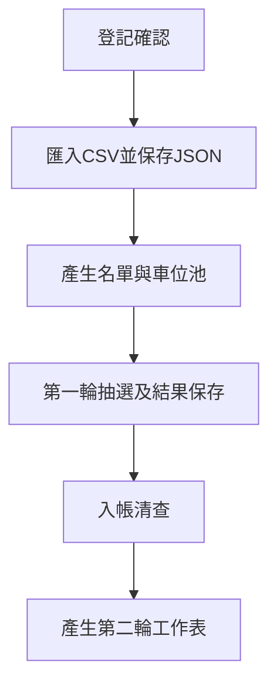

# 瑞典月灣停車位抽籤工具

支援社區年度機車與腳踏車停車位的前置登記、現場抽選、繳費清查及第二輪作業。抽選預計在會議室錄影、直播，透過前端展示參與戶別、車位數量與配位結果。

目前已建立Gin RESTful API與三層架構、0至6階段存檔與恢復、清票及兩輪配位，並提供TS／Go可重現性驗證。前端採Vite＋Vue 3＋TypeScript，Three.js為選配；CSV已可從年度inputs分階段匯入；Vue 2D操作頁已建立；報表與發布包尚待完成。

## 行政工作表

| 分頁 | 用途 |
| --- | --- |
| 填寫說明 | 行政操作與交接指引，整頁受保護 |
| A棟資料 | A棟戶號、機車位意願、大／小腳踏車登記 |
| B棟資料 | B棟戶號、機車位意願、大／小腳踏車登記 |
| 無障礙車位資料 | 按登記順序配置無障礙位，計算跨棟撥補 |
| 第一輪繳費狀態 | 依戶號分項勾選入帳，截止後配合抽選結果清查 |

機車第一輪預設全體住戶參與，行政人員登記放棄、第二輪意願及無障礙需求。腳踏車則依大小分開登記參與。欄位、保護範圍及年度副本使用方式見[行政工作表樣板](doc/design/admin-template.md)。

## 抽選規則摘要

- 機車原編號1–150；B棟基礎範圍1–85，A棟86–150。
- 無障礙位按登記順序分配14 → 2 → 3；獲配戶排除第一輪一般機車抽選。
- 未配置的無障礙原位各拆成原號及原號-1，加入B棟第一輪池。
- 每有一戶A棟取得無障礙位，依序把86、87、88撥給B棟；B棟獲配不撥補。
- 腳踏車大1–大38共38格，小39–小57共19格。大小各支援兩輪，登記超額時表格警示；無第二輪參與者則跳過。
- 三類車位第一輪未配位，以及截止後核對未繳、視同放棄的車位，都納入各類第二輪。

完整條件及未決事項以[需求文件](doc/planning/requirements.md)、[機車位配置規則](doc/planning/motorcycle-spaces.md)及[待辦](doc/planning/backlog.md)為準。

## 116年度時程

活動年度為民國116年度，以下作業在民國115年辦理，時間採臺灣時區。

| 項目 | 民國日期 | 西元日期 |
| --- | --- | --- |
| 第一階段登記 | 115/10/21–115/10/31 | 2026-10-21–2026-10-31 |
| 第一輪抽選 | 115/11/07 上午10:00 | 2026-11-07 10:00 |
| 第一輪繳費期間 | 115/11/15–115/11/30 | 2026-11-15–2026-11-30 |

截止時分、清票及第二輪日期仍待確認，見[116年度抽選時程](doc/planning/schedule-116.md)。

## 程式開發方向

應用程式以server/src（Go／Gin，Controller–Service–Repository）與client/src（Vue／TS，MVVM）分離開發；3D採TresJS整合Three.js，正式狀態、取seed、配位及存檔由Go負責，TS保留獨立驗證。Go API開發入口為`./server/run.sh server --workspace tmp/server-demo --no-browser`；Go根頁仍顯示API狀態；Vue以`npm run dev:client`分開啟動，發布打包待接。詳見[目錄配置](doc/architecture/repository-layout.md)與[Go後端](doc/architecture/backend.md)。

行政表使用文字下拉選單與入帳核取方塊；程式匯出時轉成數字代碼。活動階段另存結構化紀錄，保留各次輸入與結果，讓中斷後能恢復。完整規劃見[活動階段與CSV產出](doc/design/activity-states.md)及[架構方向](doc/architecture/overview.md)。

行政CSV匯入契約與試跑方式見[CSV匯入](doc/design/csv-import.md)及[虛構範例](examples/imports/README.md)。

Vue操作頁啟動及目前驗證範圍見[Client](client/README.md)與[2D工作台](doc/design/client-workbench.md)。

## 文件與協作

已建立0至6存檔Schema及唯讀讀取器；可用`./tools/verify-draw.sh --workspace examples/workspace --draw-round 2 --output tmp/workspace-check-001`直接核對虛構年度存檔的第二輪結果。格式與限制見[存檔Schema](doc/design/checkpoint-schema.md)。

TS／Go使用同一筆drand seed進行多池雙抽與候補驗證：`./tools/verify-draw.sh --output tmp/draw-check-001`。會保存兩邊實際消耗串流與結果並比對，亦可用--expected核對既有結果，操作與固定規格見[ChaCha20交叉驗證](doc/tools/verify-draw/tool.md)。

drand quicknet v2驗證工具可取得seed、驗證BLS簽章、換算round預定時間及保存原始資料，並支援離線重驗。執行`npm ci`後使用`./tools/drand-seed.sh fetch --output tmp/drand-latest-001`；完整指令與實測見[工具說明](doc/tools/drand-seed/tool.md)。TypeScript工具測試執行`npm test`。

本專案採Documentation as Code，以[文件地圖](doc/README.md)作為需求、規則及設計的入口。AI助理從[共用工作指示](doc/ai/instructions.md)開始；開發與提交分別遵循[開發規範](doc/conventions/development.md)及[Commit Message規範](doc/conventions/commit-messages.md)。

正式住戶名冊、繳費資料及抽選結果不提交Git。`data/`、`exports/`、`tmp/`、`logs/`及`bin/`已排除版本控制。獨立工具使用Python標準函式庫，執行方式見[清票與第二輪核心](doc/tools/round-two/tool.md)。測試執行`python3 -m unittest discover -s tests -v`；文件變更檢查相對連結並執行`git diff --check`。
