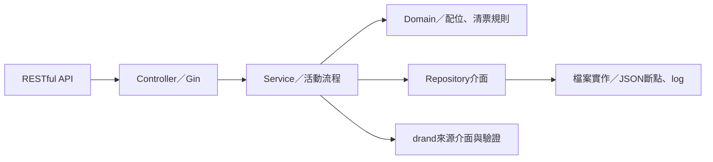
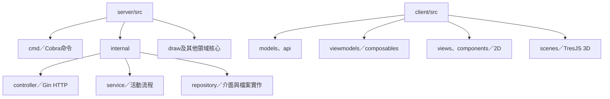

# 應用程式架構規範

狀態：2026-10-26確認並完成Go Gin與Controller–Service–Repository拆分。前端已建立MVVM目錄與責任說明；Vue介面及TresJS場景尚未實作。

## Server：Go、Gin、RESTful API

來源位於server/src，採Controller–Service–Repository分層。

| 層 | 職責 | 邊界 |
| --- | --- | --- |
| Controller | Gin路由、HTTP請求解析、DTO、回應與錯誤狀態碼 | 呼叫Service，不直接讀寫工作目錄或計算配位 |
| Service | 登記準備、無障礙配置、seed驗證、抽選、清票及階段轉移 | 組合領域核心與Repository；不依賴gin.Context |
| Repository | JSON斷點讀寫、完整提交、工作目錄鎖、恢復與log保存 | 不決定參與資格、車位池與抽選規則；第一版為檔案實作 |

Repository與Transaction介面位於service/repository.go，由使用它的Service需求定義，以建構子注入。檔案Repository委派注入的domain.Validator檢查完整性，不在儲存層重寫配位或清票規則。drand是外部來源介面，與年度存檔Repository分開。cmd使用Cobra，server與version命令各自呼叫對應模組；internal/app以Wire組裝相依並管理HTTP生命週期，見[CLI規範](cli.md)。資料儲存在檔案不影響分層，無需因此導入資料庫或ORM。

API以資源、HTTP方法與明確狀態碼表達操作；保存seed及配位屬同一次抽選流程內的兩個斷點。Controller返回成功必須以後端提交結果為準。Gin路由採activities、registrations、payment-imports、payment-reviews及rounds/:round/draws，欄位契約保持不變，見[後端API](backend.md)。

既有正式算法、Schema、0至6斷點語義與恢復規則維持其既有契約；重構須通過公開固定向量、跨語言與生命週期測試。HTTP請求取消不取消已啟動的階段作業，作業生命週期由Service管理。

## Client：TypeScript、Vue 3、MVVM

來源位於client/src，Vite負責開發及建置。2D與3D共用MVVM分工：

| 層 | 職責 | 建議位置 |
| --- | --- | --- |
| Model | API DTO、活動唯讀結果與型別、API client | models/、api/ |
| ViewModel | Vue composable：操作命令、資料轉換、畫面狀態、演出與重播進度 | viewmodels/ |
| View | Vue SFC、2D畫面與3D場景，綁定ViewModel狀態及事件 | views/、components/、scenes/ |

ViewModel以ref、reactive、computed及明確命令暴露可測試的狀態；View不直接處理正式檔案、呼叫drand或決定配位。正式活動狀態來自Go API；前端演出狀態獨立，不因動畫播放位置推進後端階段。純TS獨立重算核心保留在domain供驗證使用。

2D以Vue 3搭配HTML／CSS／SVG呈現。3D採Three.js並透過TresJS整合Vue 3；場景由同一份ViewModel衍生的車位、戶號及揭曉狀態驅動。Three.js物件與逐幀動畫限於場景呈現層，不作正式活動狀態或存檔依據。2D可獨立完成主要流程，3D仍為選配。

## 目錄與實作順序

Go分層與前端MVVM目錄邊界已建立；實際目錄見[Repository Layout](repository-layout.md)。接下來建立Vue MVVM操作流程，最後依需求加入TresJS；套件版本在導入時固定，不先安裝尚未使用的3D相依。

參考：[Gin官方文件](https://gin-gonic.com/en/docs/)、[TresJS官方文件](https://docs.tresjs.org/)、[Vue composables](https://vuejs.org/guide/reusability/composables.html)。
