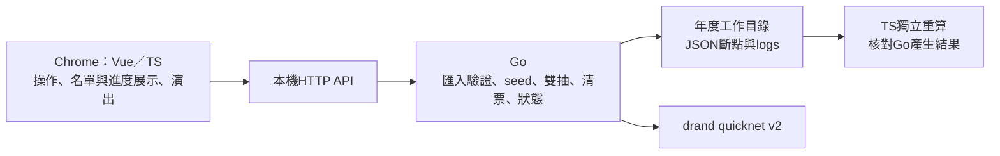
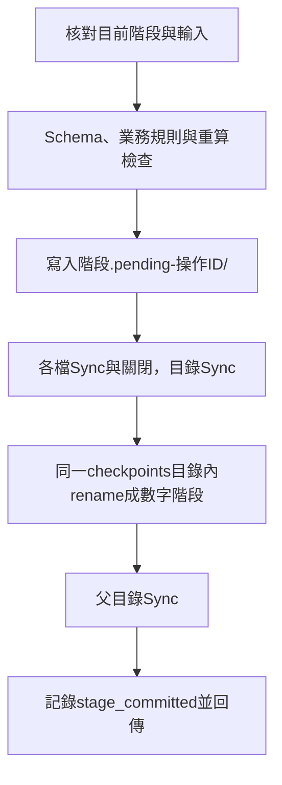

# Go後端與階段提交

基礎規範已確定：Go使用Gin RESTful API與Controller–Service–Repository，client使用Vue 3 MVVM，3D透過TresJS整合Three.js。Go已完成Gin與三層拆分；見[應用程式架構規範](application-patterns.md)。

狀態：已建立Gin RESTful API與Controller–Service–Repository、正式雙抽核心、drand v2 BLS驗證、0至6準備／計算／存檔、工作目錄鎖定與session操作log。Vue介面、CSV讀取與正規化、報表匯出及正式發布打包仍待串接，不宣稱已可直接操作行政CSV完成整場活動。

## 已確認分工



前端傳送操作意圖並讀取後端狀態／結果，不送自己計算的配位作正式結果。Go持有工作目錄及階段進度，按鈕觸發一次整輪操作，依序保存seed及配位。Chrome關閉或HTTP請求取消不取消已啟動的後端階段；Go程序仍存活時繼續保存。Go本身中斷則按已完成斷點恢復。

開發時Vite與Go各自執行，正式發布時由Go內嵌前端靜態資源。目錄配置見[Repository Layout](repository-layout.md)。目前尚未建立Vue介面，啟動後根頁暫時導向API狀態JSON。

## 分層實作

- controller/activity.go：Gin路由、Controller、JSON解析、HTTP狀態碼及Host／Origin middleware；只依賴ActivityService介面。
- service/activity.go：活動初始化、登記準備、seed／配位與清票；不依賴Gin或實體檔案API。
- service/repository.go：Service所需的Repository／Transaction介面。
- repository/store.go：檔案實作、操作序列化、階段提交、完整性檢查、鎖定與log。Transaction是整次操作的鎖定範圍，各階段仍獨立提交；配位失敗不回滾已提交的seed。
- domain：登記／車位規則、Schema與保存結果重驗，透過注入的完整性介面供Repository呼叫。
- cmd/root.go、server.go、version.go：Cobra命令與參數；internal/app管理Gin生命週期並透過Wire組裝相依，版本欄位由internal/buildinfo提供。

Gin固定v1.12.0。舊骨架路徑已換成下表資源路徑，未保留別名；JSON斷點與算法格式不變。

CLI、版本輸出與release執行檔建置見[Cobra CLI](cli.md)。

## 開發啟動

```sh
./server/run.sh server --workspace tmp/server-demo --no-browser
```

需要Go 1.26以上；script先在暫存目錄建置再執行，不要求Node啟動後端，也不改變使用者相對workspace路徑的基準。預設127.0.0.1:8080，可用--addr 127.0.0.1:0選可用埠。省略--no-browser時，以macOS open -a Google Chrome開本機狀態頁。

前端開發若直接跨來源呼叫，可明確設定--dev-origin http://localhost:5173；也可未來由Vite proxy同源轉送。服務只監聽loopback，檢查Host與Origin，不開放任意遠端頁面送出抽選操作。這不是雲端部署或多使用者服務。

不要直接指定提交的examples/workspace作寫入目錄；驗證工具的--workspace則是唯讀，可直接使用該範例。

## API骨架

| 方法與路徑 | 作用 |
| --- | --- |
| GET /api/status | 程式版本、工作目錄、activity與目前完整階段 |
| GET /api/stages/0至6 | 讀取已完成的state.json；未完成回404 |
| POST /api/activities | 以activityYear、mode建立一次活動識別，不猜年度或覆寫舊活動 |
| POST /api/registrations | 接收registrations及accessibleAssignments的標準JSON，Go排序、配置及建立0/ |
| POST /api/rounds/1/draws | 若在0/，取seed保存1/再計算保存2/；若已有1/，沿用seed完成2/ |
| POST /api/payment-imports | 接收符合3/契約的標準繳費JSON，完整保存3/，不混入清票 |
| POST /api/payment-reviews | 由0/、2/、3/計算清票、第二輪名單與候補池，保存4/ |
| POST /api/rounds/2/draws | 若在4/，取seed保存5/再計算保存6/；已有5/則沿用seed |

registration輸入契約見[registration-input.schema.json](../../schemas/checkpoints/registration-input.schema.json)。payment目前接受JSON而非CSV；後續CSV匯入必須由Go轉碼並驗證，不把正式準備邏輯搬到前端。API沒有刪除、任意跳階、任意結果上傳或自動重抽功能。

抽選API可傳入JSON `{ "buttonPressedAt": "RFC3339時間" }`，記錄前端按下按鈕的時間；省略時採後端開始操作時間，另保留實際請求及回應時間。已有seed斷點時沿用原證據。

取seed使用drand官方Go crypto套件、固定quicknet鏈與公鑰，驗證BLS後推導seed；不呼叫Node或TS。無可抽池也照常取seed。正式Go核心與TS仍可用[verify-draw](../tools/verify-draw/tool.md)獨立核對。

## 完整提交與故障恢復

工作目錄由Go持有OS檔案鎖，同一時間只允許一個後端寫入。所有階段變更序列化；執行前重新檢查正式斷點，不以瀏覽器畫面或activity舊進度判斷。



失敗不清除pending資料供debug，不覆寫已完成數字階段。若在seed階段提交前中斷，下次明確操作可重新取seed；seed已提交則不重取。rename後發生Sync或log錯誤，不能宣稱已回滾；以重新掃描正式存檔為準。

手動回退先關閉後端，再移除某階段及其後全部數字目錄，保留logs；啟動時記錄先前觀察階段與現在階段是否減少，不聲稱知道外部刪除的時間與原因。不要在後端仍持有目錄時手動改檔；鎖只防另一個合作的程式寫入，不會阻止檔案總管操作。

schema、seed證據或配位損壞時報錯；不自行刪除、修復或重建。既有存檔不依賴外部schema網路請求，JSON Schema直接內嵌Go。

## Session log

每次啟動建立新的JSONL檔，記錄UTC時間、sessionId、operationId、appVersion、事件、階段與細節，追加後Sync。主要事件：workspace_opened／workspace_closed、operation_started／completed／failed、seed_received、stage_committed及workspace_error。

seed_received不等於seed已保存，stage_committed才表示提交後的紀錄。回退不刪log，log不作恢復依據。開始操作前log寫入失敗就停止；提交後log失敗則明確回報，保留已提交斷點，不回退或換seed。

## 驗證與邊界

```sh
npm run test:server
go -C server test -race ./src/...
npm test
```

Go測試涵蓋：官方quicknet公開簽章與無重試、整個0至6生命週期對照獨立TS範例、雙開鎖定、提交前中斷、沿用已保存seed、尾端回退與歷史log保留、輸入錯型，以及HTTP來源檢查／瀏覽器取消後仍提交、Gin路由與預檢，以及並行抽選請求只取一次seed。TS與跨語言測試另驗證同一套Go正式核心的串流及全部結果。

尚待完成：社區完整戶號主檔與CSV契約、前端操作介面、可靠發布包建置、報表及現場演練。現有JSON範例為縮小的虛構登記，不代表正式行政名冊已核驗。

實作：[入口](../../server/src/main.go)、[階段儲存](../../server/src/internal/repository/store.go)、[正式抽選](../../server/src/draw/draw.go)、[BLS](../../server/src/internal/beacon/quicknet.go)。來源參考：[drand官方scheme](https://github.com/drand/drand/blob/master/crypto/schemes.go)、[JSON Schema驗證套件](https://github.com/santhosh-tekuri/jsonschema)。
