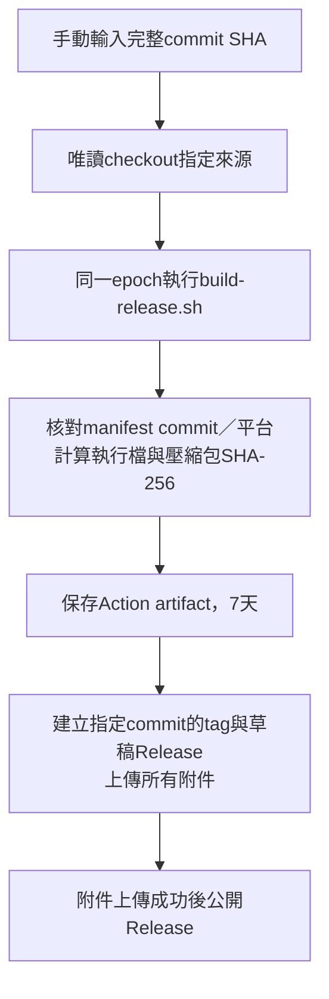

# 手動GitHub Release

已建立[Build release workflow](../../.github/workflows/release.yml)，僅由workflow_dispatch手動觸發。PR及push自動測試暫不加入，也不在此工作中執行抽選或部署Cloudflare。

## 使用

1. 將workflow提交至GitHub預設分支後，在Actions選擇Build release，再選Run workflow；workflow分支使用main。
2. commit填入此repository的完整40字元commit SHA，不使用會移動的branch名稱或短SHA。
3. 完成後到Releases下載發布包及SHA-256檔。指定的commit必須已有script/build-release.sh與其依賴來源；過早版本可能無法建置。

目前建置平台固定macOS arm64，runner為xcode-27（官方arm64 preview label）；Node固定24主版本，Go版本讀指定commit的server/go.mod。沿用該commit的npm lockfile與建置腳本。workflow本身來自觸發時選擇的分支，應與要建置的來源版本相容。

## 版本與流程

整次建置只產生一次PARKING_BUILD_EPOCH，版本為臺灣時間YYYY.MMDD.HHmm，tag為vYYYY.MMDD.HHmm，指向輸入的完整commit。相同版本的tag已存在時失敗，不移動tag、不覆寫資產；隔一分鐘重新觸發會產生新版本。



build job只有contents:read且checkout不留憑證；只有publish job具有contents:write，使用內建GITHUB_TOKEN，不需額外PAT。指定來源的建置指令不取得發布權限。建置包含既有Vue型別檢查與實際執行version／manifest核對，未新增自動測試job。

## 附件與校驗

| 附件 | 內容 |
| --- | --- |
| parking-release-v版本-darwin-arm64.tar.gz | parking、start.sh、README.md、LICENSE及manifest.json，內層保留parking-release-v版本目錄 |
| parking-release-v版本-darwin-arm64-binary.sha256 | parking執行檔SHA-256，路徑相對解壓縮位置 |
| parking-release-v版本-darwin-arm64.tar.gz.sha256 | 壓縮包SHA-256 |
| manifest.json | 版本、來源commit、buildtime、OS／ARCH及包內檔案SHA-256 |

在下載附件的目錄操作，將下方版本換成實際值：

```sh
shasum -a 256 -c parking-release-v2026.1027.0300-darwin-arm64.tar.gz.sha256
tar -xzf parking-release-v2026.1027.0300-darwin-arm64.tar.gz
shasum -a 256 -c parking-release-v2026.1027.0300-darwin-arm64-binary.sha256
./parking-release-v2026.1027.0300/start.sh --workspace ~/parking-workspace
```

Release說明亦列出完整commit與執行檔SHA-256。不包含年度名單、繳費資料、存檔、seed或憑證。此流程未加入Apple Developer簽署／公證。

若上傳或公開失敗，可能留下草稿或tag；先查該次Action與Release，不自動刪除或覆寫。Release完整附件上傳成功前不公開；Action artifact可供查錯。手動觸發本身就是發布指令，不另外加入人工核准關卡。

參考：[手動觸發](https://docs.github.com/en/actions/how-tos/manage-workflow-runs/manually-run-a-workflow)、[GitHub runner平台](https://docs.github.com/en/actions/reference/runners/github-hosted-runners)、[gh release create](https://cli.github.com/manual/gh_release_create)。

相關：[本機發布](local-launch.md)、[CLI版本欄位](cli.md)。

## Workflow驗證依據

Runner label及可用平台以官方actions/runner-images的README及對應映像文件為準；Action版本、inputs與執行需求以該Action官方action.yml、README及release為準。透過gh api核對repository權限、遠端workflow與實際run／job狀態；最終以實際指定commit的建置、tag指向、Release附件與校驗結果交叉確認。actionlint僅為本機輔助，內建runner清單可能落後，不用其未知label警告推翻官方資料，也不把略過警告當成可用證明。

2026-10-27透過gh api讀取官方runner-images README，Xcode 27的arm64 runner標示為xcode-27或xcode-27-xlarge；xcode-27-arm64是映像文件名稱，workflow採xcode-27並在執行時檢查uname -m為arm64。該image目前屬preview。
