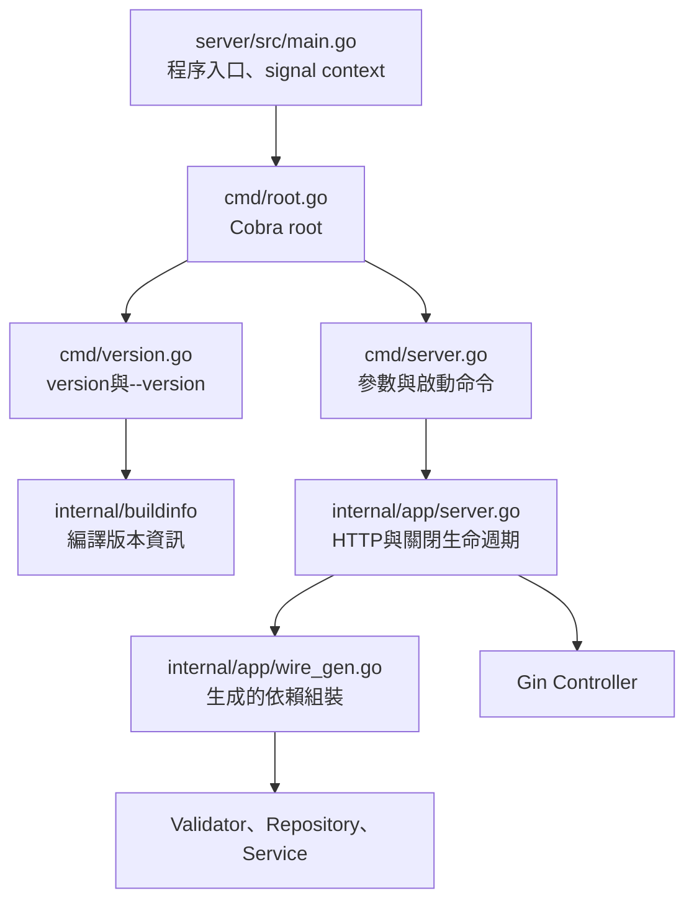

# Cobra CLI、版本資訊與依賴組裝

狀態：已實作Cobra指令、debug／release版本欄位、後端release建置腳本及Wire組裝。Vue內嵌與完整時間版本發布包亦已實作，repo操作入口集中於script。

## 指令與來源

```sh
./script/run-server.sh version
./script/run-server.sh --version
./script/run-server.sh server --workspace tmp/server-demo --no-browser
./script/run-server.sh server --help
```

建置後的執行檔接受相同指令，例如parking version及parking server --workspace。原本直接在根指令傳--workspace的方式改為server子指令。發布包start.sh接受--workspace，再轉呼叫parking server；預設自選本機可用埠號。



Root command不帶參數直接顯示help，不預設啟動server；只有明確server子指令才啟動服務。./script/run-server.sh不帶參數也顯示用法。

查詢version及help不開工作目錄、不建立log、不啟動Gin或Chrome、不取得seed。無效參數在開啟工作目錄前失敗。server保留loopback、dev-origin、workspace及no-browser參數；Ctrl+C由main的context傳到app，等待正在執行的操作完成。

## 版本欄位

未經release腳本的一般go build／go run及run.sh均為debug build，固定使用以下預設；不把執行當下的時間冒充建置時間，也不從Git自動補成release資訊：

```text
version: dev
githash: none
buildtime: none
OS: darwin
ARCH: arm64
```

OS及ARCH來自runtime.GOOS／GOARCH，表示執行檔編譯目標，不是建置主機。上面平台只是目前Mac範例。

Release後端執行檔：

```sh
./script/build-server.sh --output tmp/parking-release-test
./tmp/parking-release-test version
```

- version採臺灣建置時間YYYY.MMDD.HHmm，例如2026.1026.1339；此為格式範例，不固定在原始碼。
- githash為完整HEAD，工作樹含修改或未追蹤來源時加-dirty，避免將未提交來源標示成乾淨commit。
- buildtime為同一次建置時間的UTC RFC3339值，與version從同一個epoch推算。
- 腳本透過Go linker -X注入buildinfo的Version、GitHash及BuildTime；OS／ARCH直接由編譯目標提供。
- --output相對呼叫位置，預設repo/bin/parking-vYYYY.MMDD.HHmm；已存在則拒絕覆寫。

`script/build-server.sh`預設只建置Go執行檔，`--with-frontend`使用完整建置入口準備的嵌入資源。完整Vue／start.sh／README／manifest發布包請執行`./script/build-release.sh`，產物位於`dist/parking-release-vYYYY.MMDD.HHmm/`。正式年度資料不受建置影響，詳見[本機啟動](local-launch.md)。

## Wire

Cobra固定v1.10.2，Wire固定v0.7.0。Wire作為Go module tool依賴管理，用於編譯期產生Repository、Validator及Service的組裝程式；不在執行時使用容器。

```sh
go -C server generate ./src/internal/app
```

修改providers.go或wire.go後重新產生wire_gen.go並一起提交；不手動修改產生檔。一般build與現場啟動直接編譯生成結果，不要求現場執行Wire。Wire官方repository已封存，這裡固定使用使用者指定工具；生成結果為一般Go程式碼。

參考：[Cobra官方](https://github.com/spf13/cobra)、[Wire官方](https://github.com/google/wire)。

## 驗證

```sh
go -C server test -race ./src/...
```

涵蓋version／help無副作用、子指令與參數錯誤、context及選項轉交、Wire工作目錄鎖定與cleanup，並沿用既有抽選／存檔測試。Release欄位另以實際build後執行version核對。

已實測debug version為dev／none／none；release的臺灣時間版本與UTC buildtime一致，root與--help輸出一致，--version與version一致，並拒絕覆寫既有執行檔。另以空測試目錄啟動Cobra server，驗證Gin狀態版本及SIGTERM後的workspace_closed事件，未取得seed或建立抽選斷點。

`server --test-mode`僅將新活動的預設模式設為test，預設不帶此參數為live；API status回傳`testMode`供UI建立活動時使用。既有活動模式不變。現階段兩者只有標記差異，均會取得drand seed與寫入存檔，詳見[現場模式](../design/live-operation.md)。

新活動預設年度以伺服器啟動時的台灣西元年計算下一個民國年，經`GET /api/v1/status`的`defaultActivityYear`提供給前端；不以重新整理瀏覽器的時間改變既有活動年度。
