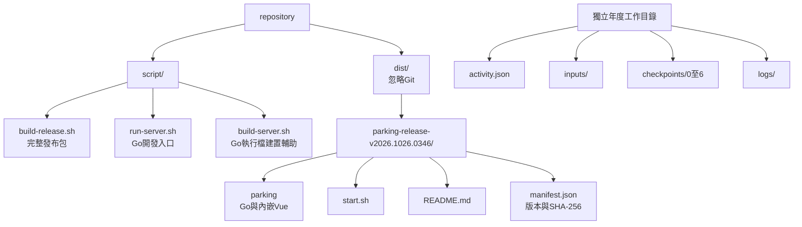

# 本機啟動與版本發布

狀態：已實作Vue內嵌Go、完整時間版本發布目錄、start.sh與manifest。Repo操作腳本統一置於script，完整產物預設位於dist。

## 建置與啟動

在repository工作目錄執行：

```sh
npm ci
./script/build-release.sh
```

產生`dist/parking-release-vYYYY.MMDD.HHmm/`，版本採建置當下臺灣時間。若需指定其他產物父目錄，可用`--output-dir`；相對路徑依呼叫位置解析。相同版本目錄已存在時拒絕覆寫；同一repo的完整建置由鎖定避免同時修改嵌入資源。

```sh
./script/build-release.sh --output-dir "tmp/release test"
```

建置需要Node、npm、Go 1.26+及Git；首次安裝依賴需要網路。Go版本欄位與發布目錄採同一個epoch，工作樹有異動時githash加-dirty。PARKING_BUILD_EPOCH可供建置呼叫鏈／測試固定同一次時間，不取代正常預設的建置時間。

建置後從發布目錄執行：

```sh
./start.sh --workspace "/Users/ellight/停車位抽籤資料/116年度"
./start.sh version
./start.sh --help
```

start.sh呼叫同目錄parking的server子指令，預設僅綁127.0.0.1，使用port 0挑選可用埠號並以Google Chrome開啟首頁；終端也會顯示實際網址。可加`--no-browser`或指定`--addr 127.0.0.1:8080`。workspace相對目前呼叫位置解析，腳本不會把它改成相對發布包位置。Ctrl+C正常關閉，等待已開始的核心操作完成。

現場只需要發布目錄及年度工作目錄，不需要Node、Go、Vite或重新建置。新seed仍需連網，既有結果、清票、重播與CSV下載不需要連網。首次使用前仍需測試現場Wi-Fi能否存取drand。

## 發布目錄與年度資料分離



發布包不包含年度資料。更新程式保留舊版本，改用新版本指向同一年度工作目錄；封存時一併備份對應發布包及年度資料。一般Go執行檔建置輔助保留bin作中間輸出，完整可交付發布包一律使用dist的版本目錄。

## 嵌入與HTTP行為

完整建置將前端輸出至`server/src/internal/webui/dist`，再以frontend build tag將靜態檔嵌入Go。該目錄與建置鎖皆為忽略的生成產物；公開來源僅包含Go嵌入與靜態檔處理程式。發布後不讀原repo或client/dist的檔案。

Gin仍統一處理Host／Origin邊界，API維持`/api/v1`。首頁提供HTML，雜湊命名assets使用immutable快取，index.html使用no-cache。未知API維持JSON 404；缺少JS／CSS亦為404，不回退成HTML；不提供目錄列表或年度工作檔案。

一般Go開發build不含frontend tag，因此仍可不經Node執行後端／驗證工具，根頁保留API狀態。前後端分離開發使用：

```sh
./script/run-server.sh server --workspace tmp/server-demo --dev-origin http://127.0.0.1:5173 --no-browser
npm run dev:client
```

## Manifest與驗證

manifest.json包含schemaVersion、version、gitHash、buildTime、os、arch、frontendEmbedded，以及parking／start.sh／README.md的完整SHA-256。版本資訊以實際執行檔輸出為準，不另產生一組不同時間。完整發布目前針對此Mac原生平台，manifest記錄編譯目標；不宣稱同一執行檔可跨OS或CPU架構使用。

已實測預設dist產物、帶空白路徑、help／version、同版本拒絕覆寫，以及僅保留系統PATH啟動。Chrome直接連發布包的Go服務，載入內嵌3D及保存結果，沒有Vite proxy、外部資源請求或寫入API；0至6的JSON前後相同。後端race測試涵蓋API與靜態資源邊界。

相關：[CLI與版本](cli.md)、[工作資料夾](../design/workspace-storage.md)、[現場模式](../design/live-operation.md)。
