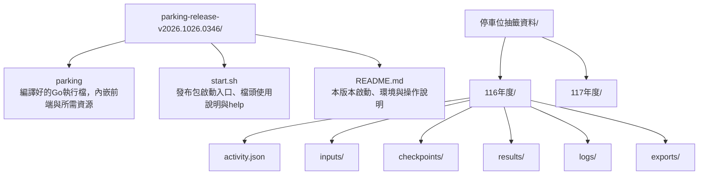

# 本機啟動與版本發布

狀態：2026-10-26已確認操作與部署方向，尚未實作啟動器、發布建置或前端。

## 現場環境與責任

- 第一版現場使用操作者目前這台Mac，外接投影機；目前不需處理換機或跨平台發布。
- 瀏覽器固定Google Chrome，不以其他瀏覽器作為第一版支援對象。
- 現場有Wi-Fi，操作者會提前測試drand存取；能否連線尚未完成現場驗證。
- Vite／Vue 3／TypeScript前端建置後，靜態資源內嵌於Go執行檔。
- Go負責提供本機localhost網頁、開啟Chrome，以及指定工作資料夾的檔案讀寫；TS負責活動流程、抽選計算與演出。
- 工作資料夾由啟動參數指定，不要求Chrome再次選資料夾或授予檔案讀寫權限。讀寫範圍限制於指定年度工作資料夾，具體API與存檔提交契約後續設計。

## 發布目錄與年度資料分離



以上年度資料結構仍為草案，細節見[工作資料夾與存檔](../design/workspace-storage.md)。正式資料不寫入發布包，也不提交Git。更新程式使用新的發布目錄，年度工作資料保持獨立；封存時保留對應發布包及年度資料。

## 啟動流程

從發布目錄執行：

```sh
./start.sh --workspace "/Users/ellight/停車位抽籤資料/116年度"
```

1. `start.sh`呼叫同目錄的`parking`執行檔，傳入工作目錄。
2. Go檢查工作目錄與既有活動紀錄，啟動本機服務並開啟Chrome。
3. 頁面顯示版本、工作目錄、年度及目前階段，操作者確認後繼續。
4. 沒有活動紀錄時進入新活動流程；已有紀錄時驗證並恢復，不能因資料損壞而默默建立新活動。

現場使用已建置的發布包，不需安裝Go、Node或npm套件，也不在現場重新建置。字型、音效與畫面資源隨包提供。取得新的正式drand seed需要連網；本機資料讀寫、既有結果查閱及重播不依賴網路，不把離線啟動誤稱為可離線取得新seed。

發布用`start.sh`沿用[Shell入口說明慣例](../conventions/tool-layout.md)的檔頭與help要求；它屬應用程式發布入口，並非目前已存在的開發工具。

## 版本號

發布目錄格式固定為`parking-release-vYYYY.MMDD.HHmm`，例如`parking-release-v2026.1026.0346`。以建置當下的臺灣時間產生，年／月日／時分依範例補零。

Go執行檔與頁面顯示相同版本，年度存檔記錄所用程式版本，便於封存及恢復時辨識。schema版本與算法版本各自管理，不以發布時間取代。相同分鐘重複建置的命名衝突處理尚待設計，不覆寫已封存的發布包。

## 接下來設計

年度活動建立與識別、Go／TS之間的存檔契約、多檔保存與中斷恢復、工作目錄鎖定及版本不相容處理。localhost埠號、Chrome啟動細節與正式建置指令仍未定案。
