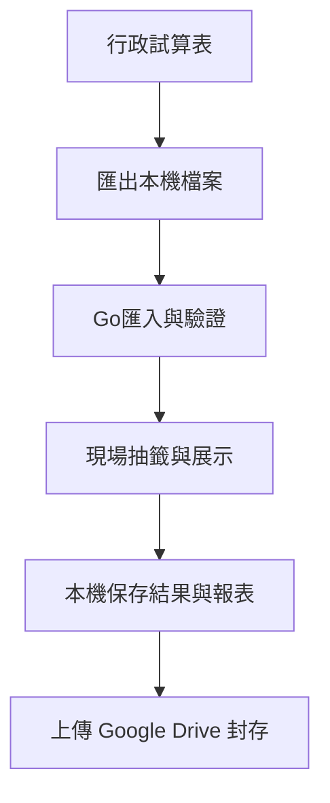

# 架構方向

狀態：前端方向已選Vite＋Vue 3＋TypeScript＋Three.js；尚未建立前端。第一版啟動採Mac＋Chrome＋內嵌前端的Go執行檔，指定年度工作目錄讀寫；已建立Go API與0至6 JSON存檔；CSV與發布打包尚待串接。前後端分離開發，來源分別為server/src與client/src，見[目錄配置](repository-layout.md)及[Go後端](backend.md)。

## 已知條件

使用者傾向離線網頁，第一輪各段獨立輸出CSV，後續按需轉格式上傳Drive；另有低優先序的戶號查詢與選配3D停車場位置展示。從產出回推的技術候選及現場存檔邊界，見[前端技術選型討論](frontend-options.md)。2026-10-26使用者選定Vite＋Vue 3＋TypeScript＋Three.js方向；使用者較熟悉TypeScript，Three.js保留為可選呈現，2D先交付。

每年約執行一次；使用者不希望維護常駐 VPC；已有 Google Drive 帳號，可上傳檔案與下載 Sheets 資料。現場需要錄影與直播展示。

## 優先評估的方案

建議以可離線執行的前端為起點，Drive 先作為資料交換與保存位置。已確認本機發布與啟動方向，見[本機啟動與版本發布](local-launch.md)；結果持久化及隔年恢復仍需實作驗證。

| 選項 | 用途 | 需要處理的問題 |
| --- | --- | --- |
| 本機檔案匯入匯出 | 第一版候選方案 | 行政下載與上傳步驟、版本辨識與遺漏防範 |
| 前端直接讀寫 Sheets / Drive | 後續整合選項 | 授權、帳號交接、網路依賴與存取範圍 |
| 常駐後端 | 目前沒有確定需求 | 年度成本、維運與隔年可恢復性 |

## 設計提案

活動階段、逐步CSV轉換與中斷恢復的規劃，集中於[活動階段與CSV產出](../design/activity-states.md)。已建立Go階段保存與恢復，不能僅以CSV檔名當作活動狀態。

- 本機存檔與重播不依賴網路；取得新的drand seed需要連網，失敗不得改成本機亂數。
- 抽籤結果與動畫分離，支援中斷後恢復及明確標示的重播。
- 封存本輪輸入、結果、報表、必要執行資訊及可重新啟動的程式版本。
- 瀏覽器內部儲存不作為唯一封存來源；仍需外部檔案與備份。
- 正式來源已選drand，ChaCha20跨語言測試已完成；Go正式配位已串接；前端演出仍待實作，見[Seed與可重現性](../design/randomness.md)。

## 定案前需驗證

現場電腦與瀏覽器、本機啟動流程、無網路啟動、保存失敗處理、刷新恢復、備份還原與隔年在另一台電腦重新使用。
