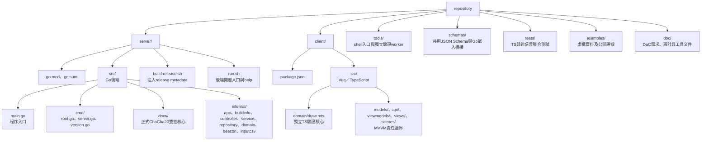

# Repository Layout

基礎規範已確定：Go使用Gin RESTful API與Controller–Service–Repository，client使用Vue 3 MVVM，3D透過TresJS整合Three.js。Go已完成Gin與三層拆分，前端已建立MVVM目錄邊界；見[應用程式架構規範](application-patterns.md)。

已確認應用程式採前後端分離開發：server為Go、client為Vue／TypeScript，程式碼各自收在src。正式發布仍以單一Go執行檔內嵌前端產物；分離的是程式責任、API與開發流程，不要求現場維護兩個服務。

- server/src/draw供正式後端及Go驗證worker共用，不維護兩套Go抽選算法。TS實作獨立，用於交叉驗證，不作正式配位的權威來源。
- tools/verify-draw/ts保留Node專用的存檔讀取及CLI；瀏覽器可用的純TS驗證核心位於client/src/domain，不將Node檔案API放進client。
- schemas/checkpoints是唯一共用資料契約來源。schemas/go.mod及embed.go僅負責把同一份JSON嵌入Go發布包，不放業務邏輯，也不在server另複製一份schema來源。
- 根package.json管理npm workspace與共用工具測試；前端相依放client/package.json。根目錄npm ci會安裝所需相依。
- server是獨立Go module，驗證工具用本機replace引用server共用核心。從根目錄執行npm run test:server，或go -C server test ./src/...。
- Go同套件測試與Go來源放同目錄；TS／跨語言測試在tests。正式資料、log與發布產物留在工作目錄或已忽略的輸出目錄，不放來源樹。

Vue頁面與Vite建置尚未建立；現有client有TS驗證核心及MVVM目錄責任說明。後端API與存檔能力見[Go後端](backend.md)，發布方向見[本機啟動](local-launch.md)。

CLI與debug／release版本欄位見[Cobra CLI](cli.md)。
