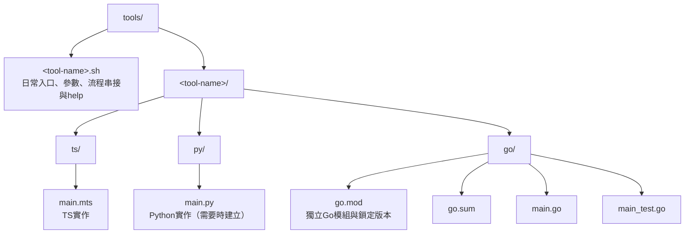
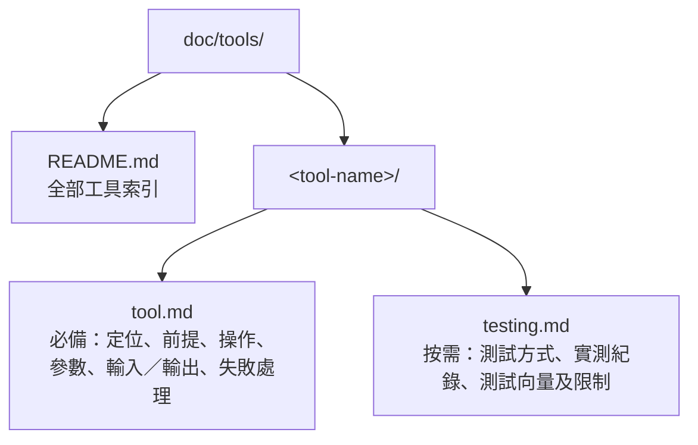

# 工具入口與目錄樣板

狀態：2026-10-26確認。後續新增開發工具以shell script作為日常執行入口；同一工具的各語言實作集中在同名目錄。既有獨立工具不要求立即搬移。

## Layout



名稱使用小寫與連字號，入口與目錄同名；依實際需要建立語言子目錄，不建立空目錄。共用輸入／輸出格式由主題文件定義，測試向量放`examples/`，執行產物放`tmp/`等已忽略目錄，不混入程式來源。

工具文件使用對應目錄，新增工具必須一併撰寫，不得只交付程式：



`tool.md`需包含shell入口與實作連結、完整可執行範例、成功判定、資料保存與覆寫規則，以及正式／測試／原型定位。相關格式規格、測試與維護文件歸入同一工具目錄，由`tool.md`連結。跨工具的產品需求與架構仍由`doc/design/`及`doc/architecture/`維護，透過連結引用，避免重複規格。

新增或調整工具須同步更新[工具索引](../tools/README.md)、shell檔頭、help與相關文件。工具更名或搬移時，文件目錄與連結一併調整。

目前範例：[verify-draw.sh](../../tools/verify-draw.sh)、[TS](../../tools/verify-draw/ts/main.mts)、[Go](../../tools/verify-draw/go/main.go)。抽取規格見[交叉驗證文件](../tools/verify-draw/tool.md)。

## Shell入口責任

- 入口使用Bash並標示shebang，設為可執行，採用`set -euo pipefail`。
- shell負責參數檢查、環境檢查、決定執行順序、啟動各語言worker與判定成功／失敗；演算法留在各語言實作，不另外建立只負責串接流程的TS入口。
- 以script自身位置找到repository及worker，不假定呼叫者目前工作目錄。使用者傳入的相對輸入／輸出路徑相對於呼叫時的工作目錄；範例統一從repository根目錄執行。
- 路徑與參數正確加引號，支援空白；避免`eval`。需要切換目錄的worker使用subshell，避免影響後續路徑。
- 在網路請求或worker執行前完成參數與輸出保護檢查。保存紀錄的工具預設拒絕覆寫，不靜默重抽或重試。
- 失敗以非零狀態結束，保留可診斷的錯誤與已取得的證據；成功的輸出與判定方式要明確。
- 各語言worker可保留獨立CLI供開發及除錯，日常操作文件以shell入口為準。

## 檔頭與help必備內容

每個入口在`.sh`檔頭註解及`--help`各保留可直接使用的說明，讓使用者只看script就能恢復操作：

1. 用途、執行前提、首次安裝與網路需求。
2. 最常用的完整指令；若支援重用既有資料，也提供完整範例。
3. 參數含義、互斥條件、輸入目錄實際需要的檔案。
4. 輸出位置、不可覆寫規則、每次需更換哪些名稱。
5. 產物清單、如何判斷成功，以及失敗保留哪些紀錄。
6. 對應主題文件位置。

無參數時顯示help；`--help`以成功狀態退出，不能發送請求、啟動worker或建立輸出。註解、help及文件的範例須同步更新。

新增工具可依下列骨架開始，再補上上述說明與實際流程：

```bash
#!/usr/bin/env bash
# 用途、前提、完整指令、輸入／輸出、成功判定與文件位置。
set -euo pipefail

usage() {
  cat <<'HELP'
用法：./tools/<tool-name>.sh --output 新目錄
此處補上完整範例、前提與參數說明。
HELP
}

if [[ $# -eq 0 || ${1:-} == --help ]]; then
  usage
  exit 0
fi

repo_dir="$(cd -- "$(dirname -- "${BASH_SOURCE[0]}")/.." && pwd)"
# 接著檢查參數、保護輸出，再以完整路徑啟動worker。
```

## 變更檢查

執行shell語法檢查及`--help`，確認help沒有副作用；依變更執行worker測試與端到端流程。路徑搬移時更新shell、import、模組識別及文件連結，並確認沒有舊路徑殘留。會保存輸出的工具另確認拒絕覆寫及失敗狀態。依風險測試含空白路徑，避免為單純說明變更增加重複測試。
