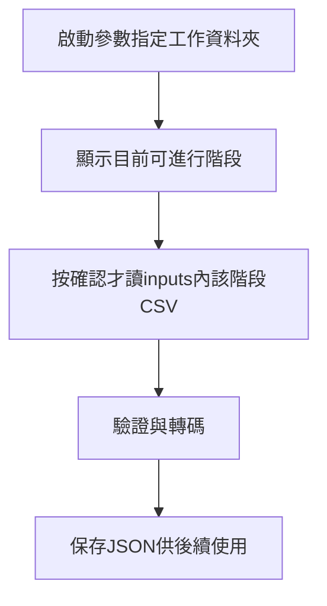

# 活動階段與CSV產出規劃

狀態：規劃紀錄，尚未實作活動狀態管理、CSV匯出或第二輪工作表產生功能。技術實作與欄位契約仍待設計。

## 工作表分工

- 第一輪工作表涵蓋登記、無障礙配置、第一輪配位結果及第一輪繳費清查所需資料。現行樣板的五個分頁見[行政工作表樣板](admin-template.md)，第一輪結果分頁尚未建立。
- 第一輪繳費狀態留在第一輪工作表，作為第一輪入帳與清票的原始依據。
- 清票確認後，程式依剩餘車位、未繳釋出車位及第二輪參與資格，產生第二輪工作表；第一輪紀錄保留，不移走或覆蓋。
- 第一輪樣板預定名稱為「第一輪機腳踏車位抽選工作表（樣板）」，年度副本可命名為「116年度第一輪機腳踏車位抽選工作表」；第二輪工作表另行產生，具體命名可再調整。

## 活動階段

### 已確認的三個操作階段

啟動及匯入方式已確認如下。新活動各階段紀錄為空；舊活動從存檔恢復，不啟動就重讀所有CSV。第一輪匯入及繳費匯入的詳細操作、目錄與失敗行為見[工作資料夾與存檔](workspace-storage.md)。

使用者確認程式採分階段匯入CSV、保存結果，再交給下一階段的方式操作。下表為操作流程；後續細分的內部狀態與檔案schema仍待技術設計。

| 操作階段 | 輸入 | 輸出及銜接 |
| --- | --- | --- |
| 第一輪抽選 | A棟資料CSV、B棟資料CSV、無障礙車位資料CSV | 登記快照、無障礙配置、第一輪配位結果及未配位車位 |
| 繳費清查 | 已保存的第一輪結果、行政填寫的第一輪繳費狀態CSV | 清票結果：已繳保留配置、逾期未繳放棄配置、第二輪可抽車位 |
| 第二輪抽選 | 前階段清票結果、登記快照中的兩輪意願、已確認的第二輪資格 | 第二輪配位、未取得車位戶別及剩餘車位 |

- 第一輪不能只讀A／B棟，還需讀無障礙資料，以處理優先配置、一般名單排除、車位拆分及跨棟撥補。
- 第一輪匯入確認時，連同兩輪意願保存快照；第二輪沿用同一份，不要求重傳A／B棟，也不自行讀取之後被修改的登記取代快照。
- 清票只在期限後確認執行，按第一輪實際配位核對入帳。第二輪可抽車位合併第一輪未配位及清票未繳釋出，依車位號碼去重並保留來源。
- 機車、大腳踏車、小腳踏車分別準備及抽選；該類沒有參與戶或沒有車位時記錄跳過。
- 每階段輸出獨立保存，活動紀錄記載輸入及結果的關聯；重新匯入不能默默覆蓋已確認資料或重新抽選。
- 畫面重播讀已保存的結果，不重新產生亂數。
- 操作者可關閉程式、手動移除某階段及其後全部存檔後重啟，依剩餘完整斷點恢復；輔助進度索引不阻擋回退，中間缺段則報錯。獨立logs/保留跨重啟操作與錯誤歷程，回退時不刪除，不以log取代斷點判定。

CSV的欄名、檔名、編碼、驗證訊息與匯入介面尚未定案；上述流程不代表Google Sheets串接、CSV工具或完整活動狀態已實作。

### 內部狀態劃分草案

以下為階段劃分草案，不是已實作的狀態名稱或API契約。

| 階段 | 來源與處理 | 預期產出 |
| --- | --- | --- |
| 登記中 | 機車全戶預設第一輪；行政登記放棄、第二輪意願、無障礙需求及腳踏車參與 | 可持續修改的工作表 |
| 登記確認 | 讀取三張來源表，檢查戶號、參與選項、無障礙順序與腳踏車名額 | 已確認登記JSON快照 |
| 第一輪準備 | 以全戶為起點排除機車放棄戶、無障礙獲配戶；處理未配置原位拆分及跨棟撥補 | 第一輪參與名單、無障礙配置及車位池JSON |
| 第一輪完成 | 執行抽籤，保存配位及未配位結果，再提供演出與重播 | 第一輪結果JSON；另行匯出CSV及報表 |
| 第一輪繳費中 | 行政人員在原工作表核對入帳 | 第一輪繳費狀態 |
| 繳費清查 | 讀取入帳並比對第一輪正式配位，確認截止後未繳 | 入帳快照、未繳及釋出車位JSON |
| 第二輪準備 | 結合第一輪剩餘、清票釋出及參與資格，避免重複車位 | 第二輪輸入JSON；另行產生外部工作表 |

只有登記意願不能代替正式配位；未勾入帳也不能直接當作欠費。清票必須使用對應的第一輪配位及已確認入帳資料。

第一輪保留預設「一輪」者不需另行登記也須納入。放棄戶不進該棟參與名單，但不刪除車位；配位後剩餘車位會進第二輪。不能為每個放棄戶預先指定某個車位空號，也不能把放棄造成的空位直接跨棟撥給第一輪使用；跨棟撥補只依已確認的無障礙規則處理。

第一輪已配機車位而期限後核對未繳，屬「已配位後放棄」，釋出其原分配車位加入第二輪。清票JSON及其對外CSV須能追溯原戶號、原車位及逾期未繳原因，與第一輪未配位車位合併時按車位號碼去重。原戶是否能參加第二輪另依資格規則判斷，不由釋出車位直接推定。

## 逐步轉換與代碼

已確認正式存檔及內部階段銜接均使用JSON。CSV只用於外部匯入與對外匯出，不作內部中間檔；下列數字代碼在JSON中保存為數值，僅在需要對外CSV時序列化。詳見[格式分工](workspace-storage.md)。

每階段只讀取必要分頁及已確認的上游結果，不要求行政人員自行整理CSV或改數字代碼。

| 工作表值 | JSON標準值／對外CSV代碼 |
| --- | --- |
| 機車位：放棄／一輪／兩輪 | 0／1／2 |
| 腳踏車：不參與／一輪／兩輪 | 0／1／2 |
| 入帳：未勾選／已勾選 | 0／1 |
| 戶號、車位號碼 | 文字識別，例如151-2、14-1、大1、小39 |

CSV本身不保存型別，匯入程式需保留識別欄文字、將代碼解析為整數。空白或不合法值須依欄位規則檢查，不默認等同放棄或未繳。Google Sheets原生下載的文字選項不是已轉碼的系統CSV。

## 保存與恢復

- 以活動年度、輪次及階段識別輸入與結果；活動年度與實際辦理年份分開，116年度活動可能於115年執行。
- 每次確認保存當時資料快照，不覆蓋前階段；後續工作表修改不得悄悄改變已完成的抽籤結果。
- 已確認以完整階段資料夾為斷點，0/為確認名單、1/為已保存seed、2/為完整配位；以內容完整性判定完成，不只看目錄或CSV檔名。activity紀錄可作輔助索引，不能取代斷點。詳見[恢復規則](workspace-storage.md)。
- drand回應尚未完成保存就中斷，重啟回到抽取按鈕，由操作者再次取seed；已完整保存seed則沿用，不因演出中斷重抽。正式存檔缺損時報錯並保留資料debug。
- 抽籤結果保存成功後才進入完成階段；演出或重播使用同一份結果，中斷後從已保存紀錄恢復。
- 確認後若需更正資料，另留新版本與更正原因；哪些更正需要重新準備或重抽，另定程序。
- 正式資料與產出不進Git，依[開發規範](../conventions/development.md)存放及備份。

機車及大／小腳踏車均採兩輪，各類第一輪剩餘及未繳釋出車位進第二輪，不以超額為前提。無第二輪參與者或無車位時分別記錄跳過，不執行亂數。共用清票及抽選核心已實作，見[執行說明](../tools/round-two/tool.md)；完整活動狀態、CSV與試算表串接仍未實作。

本次時程見[116年度抽選時程](../planning/schedule-116.md)。
