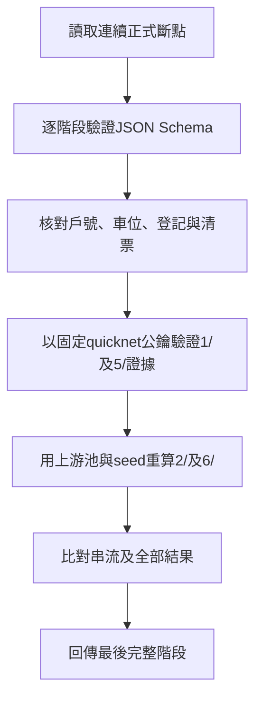

# 階段JSON Schema與唯讀驗證

狀態：已建立0至6格式版本1的JSON Schema、TS唯讀讀取器與虛構年度範例。現有驗證工具可直接核對年度存檔；Go後端已接上同一份schema、正式計算、階段提交及操作log；CSV及Vue介面仍待實作，見[Go後端](../architecture/backend.md)。

## 共通原則

**每階段只保存新增資料及結果，按順序讀上游，不複製上游內容或來源摘要。** 外部CSV來源資訊與本階段算法參數仍各自保存，不另建跨階段hash關聯。所有schema位於[schemas/checkpoints](../../schemas/checkpoints)，採JSON Schema draft 2020-12，與v2驗證器共用池／結果格式。

每個正式斷點有一份state.json。1/、5/另有原始info.json及beacon.json。現階段不要求manifest；完成判定由所需檔案、schema、語意檢查與上下游重算組成。此檢查不取代實作時的可靠提交程序，也不能證明輸入從未被整組更換。

| 階段 | Schema | state.json主要欄位 |
| --- | --- | --- |
| 0 | [stage-0](../../schemas/checkpoints/stage-0.schema.json) | schemaVersion、registrations、accessible、pools |
| 1 | [stage-1](../../schemas/checkpoints/stage-1.schema.json) | 共用seed格式：seed、round、chainHash、時間與驗證結果 |
| 2 | [stage-2](../../schemas/checkpoints/stage-2.schema.json) | 共用v2結果：算法參數、streamHex、各池結果 |
| 3 | [stage-3](../../schemas/checkpoints/stage-3.schema.json) | schemaVersion、source、payments |
| 4 | [stage-4](../../schemas/checkpoints/stage-4.schema.json) | schemaVersion、review、pools、spaceOrigins |
| 5 | [stage-5](../../schemas/checkpoints/stage-5.schema.json) | 同1/，但為第二輪seed |
| 6 | [stage-6](../../schemas/checkpoints/stage-6.schema.json) | 同2/，但為第二輪結果 |

## 欄位約定

- registrations依A、B分組，每戶含household、motorcycle、bicycleLarge、bicycleSmall，參與值為0／1／2；戶號使用門牌-樓層格式，數字排序。
- accessible包含按順位的assignments、未配置無障礙位的splitSpaces與transferredSpaces，反映已確認14、2、3分配與A棟撥補規則。
- pools每池各有id、households、candidates，把「有序戶號」與「有序車位項目」放在同一池內。候補項目只有type=waitlist、rank，不冒充實體spaceId。第一輪四池、第二輪三池順序固定。
- seed格式含schemaVersion、provider、apiVersion、chainHash、seed、round、buttonPressedAt、requestStartedAt、responseReceivedAt、roundScheduledTimeUtc、signatureVerified。時間採附時區的RFC3339字串，不混用本機請求時間與round預定時間。原始證據只在info.json與beacon.json，不把signature再複製到state。
- payments每戶三項為真正JSON布林，空白、0／1或字串不自動轉型；source只記錄外部CSV檔名、sha256及importedAt，不是上游階段摘要。
- review依機車、大腳踏車、小腳踏車分組，含retained、released及vacantSpaces；各清票清單依車位數字排序。spaceOrigins保存本步產生的車位來源分類，依類別順序及車位排序，不存上游hash。
- 結果沿用[v2契約](../tools/verify-draw/v2-contract.md)，status／reason及空集合表示一致，不另存seed或逐步trace。

activity.json為活動識別、年度、test／live模式、建立時間與建立程式版本等資訊，[格式在此](../../schemas/checkpoints/activity.schema.json)。讀取器允許其不存在；若存在就驗證，不能從目錄名稱猜年度。相容性的currentStage只作舊進度提示，不作恢復依據，不要求每次回退修改它。

## 讀取與恢復

[TS讀取器](../../tools/verify-draw/ts/checkpoints.mts)用於獨立驗證，只讀資料、不刪檔、不修復、不寫log或索引；正式Go存檔寫入由server負責。從checkpoints掃描連續0至6斷點，未有完整階段時回傳currentStage=-1。只忽略非正式目錄（如1.pending），對存在的正式數字階段要求state完整；中間缺段、未知階段、schema或檔案損壞均報錯。

原工作目錄不會被驗證工具修改；輸出必須在原目錄外，含空白路徑可用。



目前檢查包括：各池順序、數字排序、重複、登記與池名單相符、無障礙順位／排除／拆分／撥補與容量、付款戶號涵蓋登記戶、清票分類與來源一致、第二輪意願不因未繳排除、候補差額及順位、BLS簽章、seed／round一致、請求時間先後，以及結果重算一致。

一般車位的清票使用2/與3/；無障礙配置原本只保存於0/，其付款核對需讀0/的配置，不在2/複製一份。這是固定上游資料依賴，不新增重複存檔。

本階段檢查輸入存檔彼此一致，不建立完整社區戶號主檔、不代替行政核定；正式CSV匯入仍須補上完整主檔比對。已保存尾端階段手動移除後，按剩餘斷點恢復；保留後段卻刪中段則報錯，不按舊activity進度重建。

## 實際驗證

已可使用同一個shell入口：

```sh
./tools/verify-draw.sh --workspace examples/workspace --draw-round 1 --output tmp/workspace-first-001
./tools/verify-draw.sh --workspace examples/workspace --draw-round 2 --output tmp/workspace-second-001
```

workspace模式不連網、不重新取seed；唯讀檢查現存斷點後，第一輪取0/、1/、2/，第二輪取4/、5/、6/，把驗證輸入及預期結果寫入外部測試包，再交給TS與Go獨立重算。只有兩者與保存結果均一致，matches才為true。要求目標結果階段已存在，不把驗證操作當成替工作目錄完成新階段。

測試覆蓋刪除每段尾端後恢復、舊進度提示、pending目錄、中間缺段、正式檔案缺損、未知schema版本、布林錯型、seed／簽章／串流／配位／清票篡改、無障礙A棟配置與兩輪shell驗證。

驗證套件：Ajv 2020與ajv-formats，固定版本、不自動轉型或移除未知欄位。參考[Ajv JSON Schema](https://ajv.js.org/json-schema.html)、[日期格式驗證](https://ajv.js.org/guide/formats.html)。
