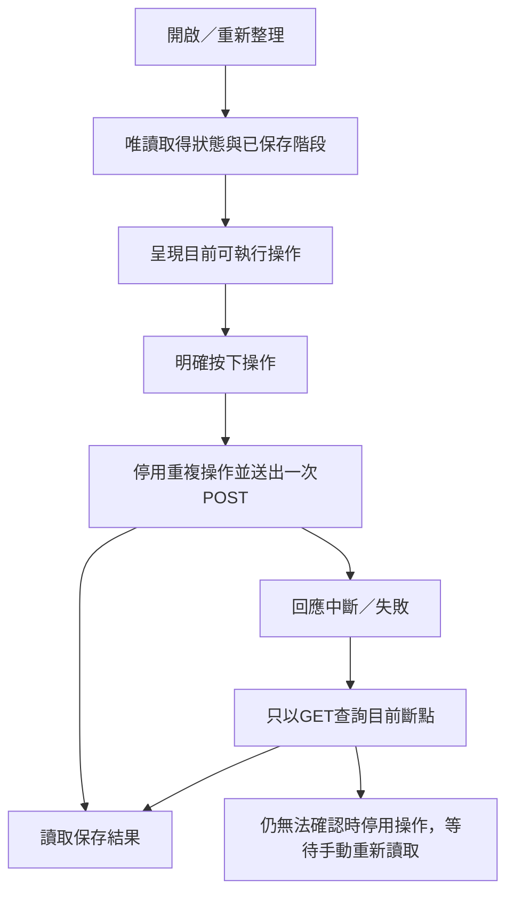

# Vue 3 2D抽選工作台

狀態：已建立TypeScript／Vue 3 MVVM、Vite開發與建置、API操作及五階段進度軸。這一版是操作工作台與結果查閱，尚非投影抽選動畫。Three.js／TresJS、報表與Go內嵌前端發布尚待完成。

## 頁面與操作

底部固定五階段進度軸。已完成階段標示完成並可回看；目前階段高亮；尚未滿足前置條件的階段不能點選。進度直接來自後端0至6完整斷點，與畫面選擇及揭曉進度分開。兩輪配位完成不宣稱行政入帳、遞補或年度結案已完成。

- 新活動：明確填民國年度並選演練／正式模式；預設演練，年度不從電腦時間推算。
- 登記：按確認才要求Go讀三份CSV，完成後可查A／B意願、無障礙配置與各池。
- 第一輪：依A棟機車、B棟機車、大腳踏車、小腳踏車切換參與戶、放棄／不參與戶、優先配置與車位池。
- 抽選：按下立即呈現臺灣按鈕時間並進入等待狀態；Go完成回應後顯示保存的round、seed、round預定時間、驗證狀態與固定round查詢連結。
- 結果：第一輪完成先停留本輪結果畫面，不直接跳到繳費匯入；操作者明確前往下一階段。各池可查看配位、候補、未配位戶及剩餘車位。
- 繳費：明確要求Go讀CSV；匯入與清票是兩個操作，可回看已保存的入帳欄位。
- 清票：顯示已繳保留、未繳釋出與第一輪剩餘；準備完成後進入第二輪，名單仍依初始兩輪意願。
- 第二輪：A／B合併機車、大腳踏車、小腳踏車；同時區分實際車位及候補項目。

工作資料夾、模式、版本與目前保存進度皆可辨識。CSV錯誤顯示原始檔名、列與欄位；斷線後的舊資料明確提示，不能繼續寫入。

## 恢復與重複操作

重新整理、回看與重開頁面均不自動POST。若後端已有1/或5/，按鈕明確寫「沿用種子完成配位」，不送新的buttonPressedAt。若只有0/或4/，才送按下當下的ISO時間。

本機Go在整次操作期間持有鎖，現有API在整輪操作完成後回覆；前端目前也在回覆後一起讀到seed與配位，不聲稱能即時訂閱seed提交的瞬間。等待時顯示按鈕時間，尚未取得資料不顯示虛構round或seed。每輪3秒差值僅呈現，不自行增加尚未確認的延遲阻擋規則。

## 程式與驗證

MVVM位置及啟動方式見[Client](../../client/README.md)。前端API僅呼叫/api/v1；不直接讀檔、請求drand或執行正式算法。TS算法核心的調整僅補上由既有驗證保證的非空型別標示，未改變算法或亂數消耗。

已完成：Vue型別檢查、Vite建置、32項TS／跨語言測試；4個本機Google Chrome模擬API測試涵蓋完整兩輪操作、CSV錯誤、seed恢復、窄畫面及1280×720短高度畫面；已檢視截圖，確認完整seed資訊在固定進度軸上方。

真正Go API與Chrome的虛構CSV整合測試亦已通過：使用實際Vite proxy、臨時埠與臨時年度目錄，建立演練活動並匯入三份CSV；重新整理仍恢復到0/，未建立seed或配位斷點。所有抽選請求在此測試被攔截，測試結束清理自行啟動的程序與目錄。

本次不執行正式抽選、不操作正式名冊，不修改Google Drive工作表。動畫、操作／投影視圖分離、現場投影字級、報表與發布整合仍需後續驗收。

投影字體放大後，桌面高度850px以下採緊湊的頁首、區塊間距與seed卡片留白，保留字級並避免公開種子卡片被固定底部進度軸覆蓋；Chrome於1280×720驗證。

工作台右上角提供「返回待機」連結至首頁；回到現場待機頁後依JSON斷點顯示目前操作及已完成階段，不重新抽選或清票。
