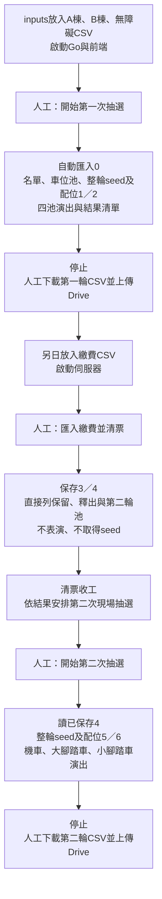

# 現場模式與獨立清票

狀態：2026-10-26依使用者最新操作方式實作。網站預設黑暗模式；首頁是現場模式，管理工作台移至`?view=workbench`，3D測試保留`?view=parking`。

## 視覺主題

使用者指定以[Nuxt UI Mono](https://ui.nuxt.com/)為參考：primary為Amber、neutral為Neutral，預設Dark。色彩語意集中於`client/src/theme.css`，既有Vue／Vite元件共用此設定；一般背景、卡片、表單及邊框使用中性灰階，不使用綠色或橄欖色底。

| 語意 | Dark設定 |
| --- | --- |
| 頁面背景 | Neutral 950，#0a0a0a |
| 卡片／浮層 | Neutral 900，#171717 |
| 表單／強調底 | Neutral 800，#262626 |
| 一般文字 | Neutral 100，#f5f5f5 |
| 次要文字 | Neutral 400，#a3a3a3 |
| Primary | Amber 400，#fbbf24；按鈕文字Neutral 900 |

圓角基準0.5rem，成功／錯誤只在狀態提示保留各自語意色。3D背景、地板、隔間與車格採對應灰階，選取及到站使用Amber；戶號對話框使用深灰底與白字。Chrome測試核對背景、主按鈕與字色，並檢查現場流程及3D顯示。

## 三次操作

兩次現場演出各只需一次開始，不再逐池按下一步或另按取得seed。清票是中間一次獨立行政作業，可完全離線進行，不併入第二次演出啟動。

## 現場演出

開始前顯示已連線工作資料夾與活動年度。新年度可在開始前設定民國年度與演練／正式模式，目前預填116及演練；已有活動沿用保存資料。首次開始會建立活動（如尚無activity.json）及匯入inputs，任何錯誤會停止，不略過檢查或自動重送POST。

每池自動展示參與名單與數量、不參與名單、無障礙優先配置（適用時），再展示車位池及數量。第一池完成車位池展示後，自動請求本輪seed並保存整輪配位；公開證據停留8秒，再播放進場。後續池沿用同一結果，不再請求seed。

名單以24筆自動分頁，每頁6秒，不參與及無障礙名單另頁展示；車位池每頁40項、每頁6秒。進場依完整名單路程與出發延遲計算長度；結果清單每頁6戶、每頁6秒，以利錄影存證。下一池接續播放，空池顯示略過與結果，不要求額外操作。提供演出前的1／2／4倍速度選擇，現場預設1倍。

第一輪A棟、B棟、大腳踏車、小腳踏車；第二輪合併機車、大腳踏車、小腳踏車。最後停在下載畫面，不自動下載、不自動開啟Drive、不自動清票。每輪seed的指令時間是自動送出抽選命令的時間，不等同較早按下本次開始的時間。

## 清票及恢復

0／1啟動可繼續第一次演出；已有seed必須沿用。2／3啟動顯示獨立清票入口，按一次依序匯入繳費與清票，保存3／4後停下。4／5啟動顯示第二次演出入口；尚未完成4不允許啟動第二次抽選。6啟動只提供下載及重播。

清票頁列出各類已繳保留、未繳釋出、原剩餘車位、第二輪參與戶數、實際車位與候補項目，供行政判斷是否舉辦第二次活動。只查看清票或完成清票不會請求drand，即使日後不安排第二次演出也不會自動取得seed。

演出位置不寫入0至6。重開後依完整斷點顯示下一項作業，也可唯讀重播已完成第一輪；重播不重新取得seed。若HTTP結果不明或檔案錯誤，停止並列錯誤，先重新讀取再人工決定是否繼續。

## 實作及驗證

`useLiveShow.ts`負責狀態、自動時序與命令串接，`LiveShowView.vue`負責現場畫面與使用者下載；Go核心與0至6契約不變。[結果CSV](result-export.md)由保存JSON產生。

測試涵蓋一次開始自動完成全部池、獨立清票不取seed、第二次僅用已準備資料、匯入失敗停止、完整結果分頁、既有seed恢復及重播不重抽。Chrome以虛構活動及模擬時間驗證三次操作與明確按下CSV下載，不在測試呼叫真實drand。
