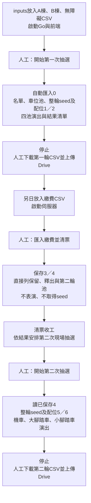

# 現場模式與獨立清票

狀態：2026-10-26依使用者最新操作方式實作。網站預設黑暗模式；首頁是現場模式，管理工作台移至`?view=workbench`，3D測試保留`?view=parking`。

## 視覺主題

使用者指定以[Nuxt UI Mono](https://ui.nuxt.com/)為參考：primary為Amber、neutral為Neutral，預設Dark。色彩語意集中於`client/src/theme.css`，既有Vue／Vite元件共用此設定；一般背景、卡片、表單及邊框使用中性灰階，不使用綠色或橄欖色底。

| 語意 | Dark設定 |
| --- | --- |
| 頁面背景 | Neutral 950，#0a0a0a |
| 卡片／浮層 | Neutral 900，#171717 |
| 表單／強調底 | Neutral 800，#262626 |
| 一般文字 | Neutral 100，#f5f5f5 |
| 次要文字 | Neutral 400，#a3a3a3 |
| Primary | Amber 400，#fbbf24；按鈕文字Neutral 900 |

圓角基準0.5rem，成功／錯誤只在狀態提示保留各自語意色。3D背景、地板、隔間與車格採對應灰階，選取及到站使用Amber；戶號對話框使用深灰底與白字。Chrome測試核對背景、主按鈕與字色，並檢查現場流程及3D顯示。

## 三次操作

兩次現場演出各只需一次開始，不再逐池按下一步或另按取得seed。清票是中間一次獨立行政作業，可完全離線進行，不併入第二次演出啟動。

## 現場演出

開始前顯示已連線工作資料夾與活動年度。新年度可在開始前設定民國年度與演練／正式模式，目前預填116及演練；已有活動沿用保存資料。首次開始會建立活動（如尚無activity.json）及匯入inputs，任何錯誤會停止，不略過檢查或自動重送POST。

每池自動展示參與名單與數量、不參與名單、無障礙優先配置（適用時），再展示車位池及數量。第一池完成車位池展示後，自動請求本輪seed並保存整輪配位；公開證據停留8秒，再播放進場。後續池沿用同一結果，不再請求seed。

名單以24筆自動分頁，每頁6秒，不參與及無障礙名單另頁展示；車位池每頁40項、每頁6秒。進場依完整名單路程與出發延遲計算長度；結果清單每頁6戶、每頁6秒，以利錄影存證。下一池接續播放，空池顯示略過與結果，不要求額外操作。提供演出前的1／2／4倍速度選擇，現場預設1倍。

第一輪A棟、B棟、大腳踏車、小腳踏車；第二輪合併機車、大腳踏車、小腳踏車。最後停在下載畫面，不自動下載、不自動開啟Drive、不自動清票。每輪seed的指令時間是自動送出抽選命令的時間，不等同較早按下本次開始的時間。

## 清票及恢復

0／1啟動可繼續第一次演出；已有seed必須沿用。2／3啟動顯示獨立清票入口，按一次依序匯入繳費與清票，保存3／4後停下。4／5啟動顯示第二次演出入口；尚未完成4不允許啟動第二次抽選。6啟動只提供下載及重播。

清票頁列出各類已繳保留、未繳釋出、原剩餘車位、第二輪參與戶數、實際車位與候補項目，供行政判斷是否舉辦第二次活動。只查看清票或完成清票不會請求drand，即使日後不安排第二次演出也不會自動取得seed。

演出位置不寫入0至6。重開後依完整斷點顯示下一項作業，也可唯讀重播已完成第一輪；重播不重新取得seed。若HTTP結果不明或檔案錯誤，停止並列錯誤，先重新讀取再人工決定是否繼續。

## 實作及驗證

`useLiveShow.ts`負責狀態、自動時序與命令串接，`LiveShowView.vue`負責現場畫面與使用者下載；Go核心與0至6契約不變。[結果CSV](result-export.md)由保存JSON產生。

測試涵蓋一次開始自動完成全部池、獨立清票不取seed、第二次僅用已準備資料、匯入失敗停止、完整結果分頁、既有seed恢復及重播不重抽。Chrome以虛構活動及模擬時間驗證三次操作與明確按下CSV下載，不在測試呼叫真實drand。

## 投影字級與進場結束時間

介面既有字級統一提高兩個2px級距（+4px），包含小字、表格、控制項及響應式字級；預設正文20px，3D戶號對話框同步放大20%。車格位置與模型尺寸不變。進場播放依實際路線、出發延遲與速度計算最後抵達時間，再停留5秒，取消原本至少30秒的等待；候補本來就在場外，不延長進場時間。播放倍速仍作用於整段演出時間。

進場演出的預設正交鏡頭縮放為全景取景的1.3倍，兩座停車場共用；重設鏡頭仍回到此倍率，可手動滾輪調整。

## 頂部進度與視窗分頁

現場演出將抽選池進度整合到標題列：目前池加大並以Amber標示，其餘池同列顯示。內容區依100dvh配置，底部資訊列佔正常版面，不覆蓋清單。ResizeObserver量測結果表格可用高度、表頭及實際列高，決定每頁筆數；住戶與車位池也依可用欄列分頁。視窗或全螢幕變更會重算，結果頁從涵蓋目前首筆的頁面重新展示，不改動保存結果。

結果每頁先展示完整清單3秒，再每秒highlight一行；前一行恢復原樣。最後一行展示1秒後恢復，再等待2秒翻頁；最後一頁結束才進入下一池。每頁採左右兩欄，各欄只有「戶號｜車位」；每側可容納筆數由實際高度決定，總容量為兩側合計。按抽出順序先填左欄由上往下，再填右欄由上往下；highlight也按同順序，每次只有一個戶號亮起。每頁時間為3秒加本頁戶數加2秒，沿用演出倍速。

## 活動模式標記（目前無獨立測試功能）

正常啟動預設建立正式活動，不顯示正式模式標籤；僅以`--test-mode`啟動時，新活動標記為test，顯示「演練模式」，前端不再提供模式選單。已有活動的模式沿用activity.json，不因啟動參數而變更；既有測試活動仍顯示演練標記。

**目前演練模式只有畫面及存檔標記，沒有獨立測試行為。** 正式與演練都使用相同算法、真實drand請求、完整JSON斷點與CSV匯出；沒有假seed、跳過寫檔、沙盒或自動清除。資料隔離靠獨立workspace。自動測試注入固定公開seed是測試程式的機制，與此啟動標記不同。

## 名單展示與快速檢核

只有第一輪A／B棟機車池顯示放棄戶及另列無障礙優先配置；腳踏車兩池與第二輪全部池只顯示參與住戶，不展示未參與／未登記兩輪的名單。

結果頁取消「配位」類型欄，直接以車位編號呈現；候補在車位欄顯示「候補 N」。每頁底部固定顯示該池的完整數量檢核，不是只計算本頁：車位總數減抽出實際車位數等於剩餘車位數；參與戶數等於抽中戶數加候補戶數。候補項目不算實際車位。任一等式不成立即顯示「數量不符，請核對」，不修改已保存資料。

## 待機頁、倍速與預設年度

第一次抽選待機頁不再顯示CSV放置與四池流程的操作說明。倍速改為右上角全螢幕按鈕上方的1x／2x／4x三格分段控制，預設1x；可在演出中切換，保留當下播放位置，之後按新速度推進，不因改倍速跳到其他頁。

新活動年度依Go伺服器啟動時的台灣日期計算：西元年減1911再加1，即下一年的民國年。例如2026年啟動預填116，2027年啟動預填117。伺服器在status回傳defaultActivityYear，前端首次載入套用一次；操作者可修改，不被後續刷新覆蓋。已有活動直接沿用存檔年度。

清票結果頁新增「下載清票報表」按鈕，輸出Markdown，詳見[結果匯出](result-export.md)。讀取已保存的4/，不請求seed、不重新清票。

## 待機頁統一配置

待機主區只保留目前階段標題及一顆執行按鈕：第一輪抽選、匯入繳費並清票、第二輪抽選；新活動仍保留年度欄位。移除清票與第二輪待機的流程說明及混在主區的歷史操作。全部完成後顯示完成狀態，不增加新的抽選操作。

下方獨立「已完成階段」區，依完成斷點由上到下顯示：

1. 第一輪抽選（2/完成）：重播第一次演出、下載第一輪CSV。
2. 清票（4/完成）：查看已保存清票結果、下載清票Markdown報表。
3. 第二輪抽選（6/完成）：重播第二次演出、下載第二輪CSV。

尚未完成的階段不出現。清票沒有演出，所以歷史操作是查看結果；不重新匯入、不重做清票，也不取得seed。抽選重播沿用既有結果。
