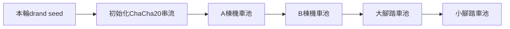

# 抽選seed與可重現性

狀態：2026-10-26已確認採用drand quicknet v2作為正式seed來源及來源證明；已建立ChaCha20的TS／Go交叉驗證測試，已確認整輪共用seed、連續串流及直接取餘數，正式核心與測試工具尚未依新規格更新。現有Python工具保留作清票／第二輪規則原型，使用SystemRandom，不能作正式drand抽選入口或宣稱已有seed重現功能。

使用者指定先驗證ChaCha20及遞減池抽取：相同drand seed交給TS與Go，從1～150依序抽出、移除並逐筆比對。工具與固定測試規格見[ChaCha20交叉驗證](../tools/verify-draw/tool.md)。此測試尚未串接住戶配位；下方算法提案不代表正式實作已完成。

## 已確認：整輪共用seed與直接取餘數

每輪一次取得一個256-bit seed，初始化一條ChaCha20亂數串流，第一輪依下圖順序連續消耗。各池的車位獨立，換池不重新seed、不重設串流；無參與戶或無可抽項目跳過、不消耗亂數。第一輪完成整輪配位才一次保存結果，再由前端分段演出，核心state不跟演出同步。第二輪另取該輪seed，按實際池處理，不將第一輪A／B分池規則套入第二輪。

第一輪與第二輪均採雙抽，每次固定先從車位池抽取並移除一個項目，再從戶號池抽取並移除一戶，保存配對。兩次取值依序消耗同一條串流，抽出元素後維持剩餘池順序；每次直接使用下一個uint32的`random % 目前池大小`，不做拒絕取樣。任一池只剩一個元素時直接取出，不讀亂數；戶號池或有效抽取項目池用完即停止。初始有序輸入依[存檔規劃](workspace-storage.md)，排序不再代表優先取得車位。

第二輪各類實際車位不足時，車位池補入候補項目，讓抽選同時決定實際車位及候補順位。實際配位數與候補數分開統計，候補不是實體車位。完整候補規則見[活動流程](../planning/workflow.md)。

第二輪順序已確認為A／B合併機車池、大腳踏車池、小腳踏車池，以5/的seed建立一條串流，6/保存消耗串流與整輪結果；資料結構分別沿用第一輪1/與2/。輸入直接讀4/，不複製前階段資料。

每輪照常請求、驗證並保存drand seed，即使所有池都無可抽內容也不省略；只有配位可記錄status為skipped與reason。每池無參與戶或無可抽項目時不消耗亂數；第二輪各類先補候補項目再判斷。整輪都跳過時實際消耗串流為空，seed及原始簽章證據仍完整保留。部分池跳過不影響其他池使用整輪seed。完整表示見[存檔規劃](workspace-storage.md)。

例如無人放棄、無人登記無障礙位：A棟65戶／65格，逐組依序抽車位%65、戶號%65，再車位%64、戶號%64，直到兩池最後一項直接配對。B棟85戶／88格，首組車位%88、戶號%85，最後一組車位%4、戶號直接取最後一戶，剩3格。腳踏車池以車位編號為準：大1～38、小39～57，亦採雙抽。

### 決策理由與驗證範圍

使用者的取捨：活動前不固定哪個drand round，現場於不定時間點按鈕取得latest，搭配錄影與來源簽章，已符合本社區年度活動希望的隨機程度與操作需求。接受直接取餘數的極小偏差，不要求百萬筆分布統計或以轉蛋法規等級作驗收。本段記錄專案需求與取捨，不是法律適用或法規符合性判定；按鈕時間不固定也不會消除取餘數的數學偏差。

仍保留BLS來源驗證、固定測試向量、TS／Go逐筆一致、配位唯一性／完整性、資料保存與重啟重現檢查。降低統計驗證需求不代表省略功能正確性檢查。現有`parking-draw-chacha20-v1`工具仍採拒絕取樣且n=1消耗亂數，是舊測試規格；新規格需更新版本、兩邊實作與測試，不能直接宣稱已完成。

按下抽取時向drand quicknet v2請求latest，驗證BLS簽章後，以SHA-256(signature bytes)取得256-bit seed，保存為完整十六進位字串。固定鏈與驗證方式見下方；不以本機亂數替代正式seed。正式配位不使用`Math.random()`；動畫需要的亂數獨立，不消耗正式配位亂數序列。

seed本身不夠重現結果，必須一併固定：

- 活動ID、輪次、段落ID與嘗試識別。
- 實際參與戶及車位池快照，含明確輸入順序及正規化規則。
- 規則版本、亂數生成器名稱與版本、洗牌算法版本、必要的整數／位元規格。
- 分階段保存的seed、有序輸入、實際消耗串流與正式配位結果；驗證時依順序讀取，不在後續state複製前階段內容或摘要。

ChaCha20的key／nonce／counter及uint32讀取方式沿用已驗證工具的明確規格；直接取餘數與最後一格不消耗亂數是本次新決策。串流可按需產生，不要求預先建立整輪亂數陣列。

## 已確認的保存與恢復順序

1. 確認名單與車位池，完整保存0/後顯示抽取按鈕。
2. 按下抽取，記錄當下時間並請求drand latest；取得及驗證seed後完整保存1/，成功後才進入配位計算。
3. 從已保存seed與固定輸入計算並檢查完整配位，一次提交結果至2/。
4. 結果保存成功才播放演出；演出不算核心存檔階段。

使用者確認以完整存檔為斷點：drand已回應但1/未完成保存即關閉，重啟回到0/並顯示抽取按鈕；再次按下可重新取得latest及新的seed。這取代早期「發出請求或已有啟動紀錄便必須找回同一seed」的建議，不自動重試。

1/完整而2/未完成時，必須使用已保存seed恢復計算；2/完整時直接讀結果重播，不換seed。後續3/保存繳費匯入、4/保存清票及第二輪名單／車位池，第二輪seed保存5/，第二輪整輪配位保存6/，沿用相同seed與結果分開提交的規則。正式存檔損壞屬錯誤，保留資料以debug，不自動回退重抽。斷點內容與暫存提交提案以[工作資料夾與存檔](workspace-storage.md)為準，seed作用範圍為整輪。

已確認手動回退：操作者關閉程式並移除最後的結果斷點2/後，沿用1/重新計算；若1/是最後階段，移除它則回到0/，可再按抽取取得新seed。這是操作者明確移除存檔後的恢復規則，不是程式自動重抽。

## 現場與封存

已確認：每輪按下抽取時，立即顯示當下本機時間，並隨完整seed斷點保存該時間（臺灣時區）；取得資料後在同一畫面顯示drand round、完整seed、round預定時間及簽章驗證狀態，讓現場與實況錄影能核對。保存按鈕時間、請求起迄、鏈資訊、原始簽章回應及驗證結果，並提供該鏈固定round的API查詢網址。顯示欄位與流程見[前端演出](presentation.md)。

quicknet每3秒一輪，正常連線下預期錄影中的當下時間與取得round的預定時間約在一輪內；這是操作預期，不是硬性保證。網路、快取與本機時鐘會影響差值，畫面及紀錄保留實際差值，不宣稱drand簽章證明本機按鈕時間。超過一輪時是否阻擋抽選仍待確認；完整seed斷點已保存後不換round，未保存而中斷則依上述恢復規則處理。

drand作為亂數來源及簽章證明；錄影保留現場取值過程。可重現仍須固定輸入與算法，來源簽章本身不證明未挑選round或完成整場活動審計。

禁止將取消演出視為取消抽選，或為了重新播放生成新seed。正式重抽的條件、核准及原結果作廢程序仍待確認；演練另開測試活動，與正式存檔清楚分開。

## 驗證要求

正式2/state.json保留實際消耗的原始串流hex及整輪結果，不重複保存逐步池大小或索引。驗證先由seed重建等長串流比對bytes，再從固定輸入及串流重算配位；內容契約見[存檔規劃](workspace-storage.md)。

固定測試向量需驗證跨啟動重現、名單排序規則、車位唯一性、名單多於／少於車位、無參與者跳過、動畫不影響配位、seed已存但結果未存的恢復，以及已存在結果時拒絕再次抽選。

## 第三方公開驗證選項

後續狀態：使用者確認RANDOM.ORG開發key不適合正式環境，正式抽選先不採用；已完成測試仍作開發紀錄。正式來源已選drand quicknet v2；NIST僅保留調查紀錄。

使用者提出本機seed缺少外部審計的疑慮。以下保留方案調查；drand已定案，其餘服務未採用。

### drand公開亂數＋事前資料承諾

2026-10-26使用者確認採用quicknet：chain hash為`52db9ba70e0cc0f6eaf7803dd07447a1f5477735fd3f661792ba94600c84e971`。已讀官方鏈info核對period=3秒、genesis_time=1692803367、schemeID=bls-unchained-g1-rfc9380。與先前測試的default 30秒chained鏈不同，公鑰及驗證scheme必須一併切換，不能只換URL。

quicknet公鑰：`83cf0f2896adee7eb8b5f01fcad3912212c437e0073e911fb90022d3e760183c8c4b450b6a0a6c3ac6a5776a2d1064510d1fec758c921cc22b0e17e63aaf4bcb5ed66304de9cf809bd274ca73bab4af5a6e9c76a4bc09e76eae8991ef5ece45a`。固定鏈資訊應封存並隨程式固定，不逐次信任任意來源的公鑰。預定round時間為`1692803367 + (round - 1) * 3`（Unix秒），不是服務端收到請求或實際回應時間。

採用v2查詢路徑：`https://api.drand.sh/v2/chains/<chainHash>/rounds/latest`及`https://api.drand.sh/v2/chains/<chainHash>/rounds/<round>`。quicknet為unchained，不能要求一定有previous_signature；仍需驗證每筆簽章及randomness。若選按鈕後等待下一輪的演出，先保存指定round，再等待並驗證同一round；按鈕與資料發布交界造成的延遲或失敗不得偷偷換輪。

drand提供固定round的公開亂數及可驗證簽章，支援事前指定未來round。適合保留本機抽選演出的架構，但drand本身不保存本社區的登記、配位或活動審計頁。

更強的事前承諾方案（未採用為目前操作流程）：在亂數公布前，固定並對外公布活動ID、排序後的名單及車位池摘要、規則／算法版本、指定鏈識別與未來round、段落及seed推導方式；之後取得該round並驗證簽章，依公開算法推導各段seed及配位。不得看過結果再換round、輸入順序、nonce或推導規則，此方案與目前已確認的按鈕時請求latest流程不同，若日後需要再另行確認。

資料承諾需有外部可核對的事前發布／時間證據。只把hash寫進同一台電腦或事後上傳Drive，不能獨立證明是在亂數揭露前定案。稽核包需保存承諾原文、發布證據、完整規則及輸入、鏈公鑰／識別、round、簽章、推導算法、各段seed與結果。取得公開beacon後可本機運算及播放；無網路時可由別台設備帶入同一round的簽章資料，不偷偷改成本機亂數或換round。

### RANDOM.ORG服務

測試工具已獨立建立：見[第三方seed測試腳本](../tools/random-org-seed/tool.md)。支援generateSignedBlobs、getResult及verifySignature，使用者已完成兩筆真實generate／get／verify測試，取回紀錄一致且簽章驗證通過；尚未串入正式抽選。

使用者澄清主要需求為：按抽選時向第三方請求seed，取得第三方提供的時間戳、seed原文及可驗證憑據，配位仍在本機執行。這與將整個抽選交給第三方不同；同seed必須搭配相同算法／版本、輸入順序及呼叫規格，才會重現相同配位。

Signed API的`generateSignedBlobs`可作候選，請求一份256-bit hex資料作seed；回應random物件包含data、completionTime（服務端產生完成時間）、serialNumber及userData，另有signature。可將活動ID、輪次、段落、名單／車位池摘要及算法版本納入userData，保存完整random與signature，不自行重排或改寫已簽原文。signature可透過官方驗證表單、verifySignature或離線公鑰方式查驗來源及完整性。

需區分：completionTime是服務完成亂數產生的時間，不是本機按鈕點擊時間；Signed API不是自動公開活動網址。官方提供getResult，以API key及serialNumber取回，保證保存至少一年，不保證永久；因此每年活動必須自行封存完整簽章回應。若需任何住戶直接瀏覽的第三方紀錄頁，另評估Verification Trail或專門抽選服務，不混稱Signed API本身即有公開審計頁。

- Verification Trail Service提供公開或私人的randomization紀錄，含參數、時間戳與驗證碼，已保存紀錄依服務說明不能修改或刪除，較接近「第三方有網址可查」的需求。
- Third-Party Draw Service由第三方執行抽選並提供結果查驗，屬需帳號及付費額度的服務；其選出得獎者模型能否適配完整車位一對一配置，需另驗證。
- Signed API可回傳簽章亂數並將userData納入簽章；官方明確說明userData單獨不能防止多次請求挑結果，不能把有效簽章直接視為從未重抽的證明。需要帳號／API key，如何安全授權及公開全部嘗試需另設計。

第三方亂數來源、第三方不可變活動紀錄及獨立稽核是不同能力；選型需明確決定住戶要查的是來源簽章、完整配位重算，還是服務商保存的活動紀錄。任何來源仍需確保名單、車位及配位算法在揭露亂數前已固定。

官方來源：[drand規格](https://docs.drand.love/docs/specification/)、[drand公開驗證說明](https://docs.drand.love/blog/2023/06/02/drand-explainer/)、[RANDOM.ORG Verification Trail](https://trails.random.org/)、[第三方抽選](https://www.random.org/draws/)、[Signed API限制](https://api.random.org/signatures)。

### drand與NIST的驗證區別（2026-10-26查核）

已實作[drand quicknet v2驗證工具](../tools/drand-seed/tool.md)，支援latest、指定round及保存原文的離線BLS驗證。round 33382601已完成連線及離線驗證，並推導seed與預定時間；尚未串入正式抽選。下述6583935是不同鏈的舊樣本。

- drand：固定鏈hash及受信任公鑰，依鏈scheme驗證BLS簽章，再核對SHA-256(signature bytes)是否等於randomness。只核對hash不構成來源驗證；由同一未信任回應臨時取得公鑰也不能建立獨立信任根。官方建議使用[drand-client](https://github.com/drand/drand-client)，保持disableBeaconVerification=false及指定chainVerificationParams。
- 使用者提供round 6583935的signature已在本機核對SHA-256與randomness相同；尚未由agent執行BLS驗證，不能宣稱該筆來源驗證通過。驗證時應查固定round，不再次查latest造成不同筆比對。
- drand回應不含本次request完成時間；round對應的預定時間可依固定鏈的genesis_time及period推導。這不是專屬於本活動的請求收據，而是大家共用的公開beacon。
- NIST：需取得pulse的簽章憑證，驗證信任與certificateId，依其規格序列化及驗證signatureValue，核對outputValue的生成規則；不能把pretty-printed JSON直接交給RSA驗證。
- [NIST官方頁](https://csrc.nist.gov/Projects/interoperable-randomness-beacons/beacon-20)於2026-10-23公告：2026-09-03起的pulse引用錯誤certificate，驗證需要改用不同憑證，後續將補歷史說明。使用者貼出的2026-10-25 pulse落在影響範圍，因此暫不把它列為已可正常驗證的正式來源。這是當日查核狀態，不是永久結論。

同筆資料查回一致、hash綁定一致、第三方簽章有效、資料足夠新鮮及活動未挑選round，屬不同驗證；不能只驗其中一項就宣稱整個抽選已被審計。

## 參考

- [Crypto.getRandomValues](https://developer.mozilla.org/en-US/docs/Web/API/Crypto/getRandomValues)：瀏覽器提供密碼學強度的隨機值。
- [Math.random](https://developer.mozilla.org/en-US/docs/Web/JavaScript/Reference/Global_Objects/Math/random)：不提供密碼學安全亂數，也不能由使用者設定或重設內建seed。
- [SubtleCrypto.digest](https://developer.mozilla.org/en-US/docs/Web/API/SubtleCrypto/digest)：SHA-256等內容摘要功能。
