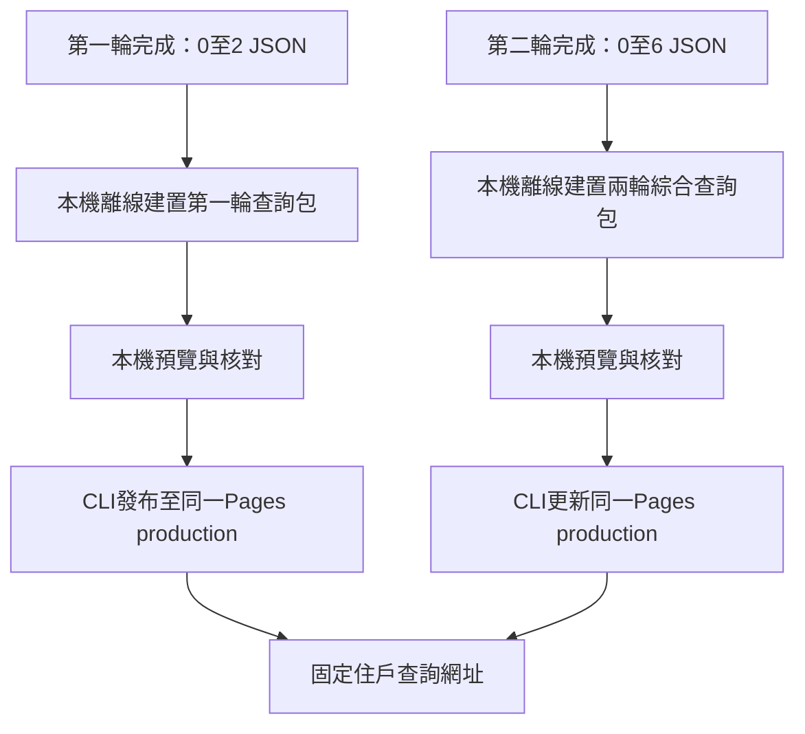

# 住戶靜態查詢與Cloudflare Pages發布

狀態：2026-10-27確認使用Cloudflare Pages免費靜態託管，從年度存檔離線建置，再以CLI手動發布兩次。離線建置腳本及獨立查詢頁已實作並以Chrome驗證；CLI上傳為獨立手動操作；115歷年預覽已部署parking115專案並設定年度子網域，116尚未建立，見[部署紀錄](../tools/build-query/deployment.md)。操作見[build-query](../tools/build-query/tool.md)。

## 兩次發布，同一查詢網址

1. 第一輪完成後匯出一次，提供第一輪抽出車位查詢。
2. 第二輪完成後再匯出一次，發布到同一Pages專案的production環境，更新相同網址，提供兩輪綜合查詢。

清票是本機中間階段，本年度預定不在清票後額外發布第三個版本。網站按年度使用`parking115.ellight.monster`／`parking116.ellight.monster`，專案為parking115／parking116、production branch為main。Namecheap維持網域註冊與續費，Cloudflare處理現有DNS與Pages託管，不要求啟用GCP、AWS或付費GitHub。



## 查詢資料語意

| 發布版本 | 存檔來源 | 住戶查詢內容 |
| --- | --- | --- |
| 第一輪 | activity及0至2 | 第一輪機車、大／小腳踏車抽中結果，包含無障礙優先配置；這是清票前的抽中結果，不宣稱已繳或最終有效 |
| 第二輪 | activity及0至6 | 第一輪已繳保留車位加第二輪新增車位，以及各類候補順位；同戶可能有多個有效車位，須全部列出 |

第二次輸出不能直接把2/與6/全部配位串起來：第一輪已釋出的車位不能再當成原戶有效車位。有效第一輪車位以4/的retained為準（包含保留的無障礙位），第二輪新增以6/的assignments與waitlist為準。查詢可保留第一輪抽中歷史，已釋出者清楚標記「已釋出」，不列作該戶目前有效車位；不公開繳費明細。

網站須標示年度、目前公布至第幾輪、建置版本，避免住戶誤將第一輪頁當成兩輪最終配置。第二輪結束時尚無第二輪繳費快照，因此第二輪結果是抽中／候補結果，不代表已完成第二輪繳費；後續行政依候補遞補不由網站自行推定。

住戶輸入戶號後，同時列出機車、大腳踏車、小腳踏車的有效車位及候補。沿用現有B1／1F模型、車位highlight與戶號物件進場：有車位者進到對應位置，候補停場外。3D不支援時仍提供文字結果。無障礙拆分依0/保存配置，不重新讀行政CSV。

## 離線建置入口

Repo操作腳本放`script/`，使用`script/build-query.sh`，帶入workspace，可選輪次與新輸出目錄。預設auto依完整斷點判斷第一輪或兩輪，預設輸出repo的dist版本目錄；也可明確指定：

```sh
# 第一輪公布包
./script/build-query.sh --workspace ~/testwork-waitlist --round 1 \
  --output ~/testwork-waitlist/exports/query-round1-v2026.1027.0100

# 第二輪公布包
./script/build-query.sh --workspace ~/testwork-waitlist --round 2 \
  --output ~/testwork-waitlist/exports/query-round2-v2026.1027.0200
```

- 不啟動Gin或Chrome，不呼叫drand，不重新抽選或清票；只讀取及驗證已提交JSON。第一輪需完整0至2，第二輪需完整0至6；缺檔、資料損壞或算法驗證不一致則停止。
- 建置依賴事先安裝；依賴備妥後，資料轉換、前端建置與存檔核驗均可斷網執行。上傳與第一次CLI授權另外連網。
- 產出獨立HTML／CSS／JS、3D場景與最小公開查詢資料；網站運行不依賴Go、API、Google Drive或drand，也不包含管理／抽選介面。
- 每次建置放新目錄，拒絕覆寫既有輸出，保留前次包供備份。完成後才將該目錄交給發布程序；不將整個workspace當上傳來源。
- 輸出只含戶號、查詢所需車位／候補／輪次與配置狀態，以及必要年度、版本與場景配置。原始CSV、付款明細、logs、鎖定檔與完整checkpoint不公開，不進Git。
- 文字資料與前端assets使用版本／內容雜湊檔名，入口採重新驗證快取，避免第二次發布後混用舊資料。版本資訊與建置摘要一併保存，細節實作時定義。

純靜態查詢不提供登入授權；輸入戶號是查詢介面，不是資料存取限制，公開資料可被下載。

## CLI發布

採Cloudflare Pages Direct Upload，用Wrangler CLI上傳已建置目錄；本機建置與上傳為兩個獨立操作，建置不自動發布。Wrangler登入、建立專案及綁定網域為一次性設定，憑證不放入repo或公布包。

下列為官方CLI使用範例，需先安裝Wrangler、登入並完成專案設定；`parking-query`及`main`是示意值：

```sh
npx wrangler login
npx wrangler pages project create parking-query --production-branch main
npx wrangler pages deploy ~/testwork-waitlist/exports/query-round1-v2026.1027.0100 \
  --project-name parking-query --branch main

# 第二次仍使用相同專案與production branch，更新既有網址。
npx wrangler pages deploy ~/testwork-waitlist/exports/query-round2-v2026.1027.0200 \
  --project-name parking-query --branch main
```

Wrangler可由repo預先鎖定版本的依賴提供，避免年度操作時依賴未固定的最新版；具體安裝與包版方式待實作。不將部署到任意新branch誤認為正式網址已更新。既有發布包本機保留，網站更新不會刪除本機年度存檔。

已完成本機靜態建置與Chrome查詢測試；115歷年預覽已依使用者明確指示上傳並設定DNS，正式116年度公布仍待抽選完成後另行操作。

## 免費方案與參考來源

2026-10-27查閱官方文件：純靜態檔案請求免費且不限次數；Free每站最多20,000檔、單檔25MiB，控制台拖曳上傳上限1,000檔。此專案不需要Pages Functions或常駐伺服器。額度與服務規則可能變動，正式發布時重新確認。

- [Cloudflare Pages計費](https://developers.cloudflare.com/pages/functions/pricing/)
- [Cloudflare Pages限制](https://developers.cloudflare.com/pages/platform/limits/)
- [Direct Upload及Wrangler](https://developers.cloudflare.com/pages/get-started/direct-upload/)
- [自訂網域](https://developers.cloudflare.com/pages/configuration/custom-domains/)

相關：[存檔與恢復](workspace-storage.md)、[停車場模型](parking-scene.md)、[本機發布包](../architecture/local-launch.md)。

## 2026-10-27：全版查詢介面

查詢頁預設以B1機車停車場模型鋪滿視窗，不使用瀏覽器全螢幕API強制切換。中央顯示「請輸入戶號」；取得有效戶號前不顯示儀表板，背景場景不可操作，鍵盤焦點限制在輸入區。查詢成功後收起中央表單，優先播放該戶機車，無機車紀錄時播放其他類別；同戶所有有效車位與候補仍完整列出。無抽中或候補者也能查看明確文字結果並重新查詢。

桌面採右側懸浮儀表板，每個section可獨立摺疊，依序為：

1. 視角：斜視／俯視、重設。
2. 播放控制：橫排「重新播放」按鈕在左、「馬上就位」核取方塊在右。勾選立即落位，取消則由入口重新播放；勾選狀態也套用切換的其他紀錄。按「重新播放」取消馬上就位、恢復跟隨，保留斜視／俯視選擇並從入口重播。
3. 查詢結果：車位及候補清單、查看位置；已釋出紀錄另列先前結果。
4. 重新查詢：清除目前戶號、結果選取、播放狀態及鏡頭操作，回到中央輸入區與B1背景。

未手動調整視角時，鏡頭聚焦並跟隨目前觀看的車輛，含候補場外位置；拖曳或滾輪縮放後進入自由視角，不再自動拉回。斜視／俯視切換與單純點擊物件不停止原有跟隨；已在自由視角時，切換視角也不自行恢復跟隨。按重設恢復預設斜視與跟隨。切換同停車場的查詢項目不重建鏡頭，以保留手動視角。

使用者已選定手機採「底部可收合面板，上方保留模型」：功能與桌面同序，展開最高約44%視窗高，內部可捲動；收合只顯示戶號及展開按鈕，仍保留模型操作。中央戶號輸入邏輯與桌面相同。WebGL不可用時保留文字查詢功能。

查詢頁左上標題區固定顯示「查詢結果僅供即時預覽，實際車位請以社區公告為主。」桌面與手機、輸入前與查詢後皆保留，不因面板收合而隱藏。

## 先行裝置相容性預覽

正式116年度抽選前，使用本機115年度歷年結果建置一版Pages，讓住戶先確認手機／電腦、查詢及3D是否正常。戶號、配位與候補沿用操作者提供的Excel，資料保留testMode標記，畫面依使用者要求不顯示演練標籤，保留115年度及公告優先提示。此查詢專用JSON用`build-query.sh --query-data`處理，不需要也不偽造seed與簽章；真實資料僅保存在本機testdata，忽略Git。正式抽選仍在操作者電腦運行，之後再用完整JSON存檔更新網站。

桌面左上年度、查詢標題及公布輪次共用與公告警語相同的半透明深色底，確保模型背景下可讀。查詢頁不顯示「演練資料」標籤；資料testMode欄位仍保留供建置驗證，年度照常顯示。

候補單戶查詢以同車種類型、同輪的完整候補順位範圍建立場外隊列，再顯示該戶位置；不以目前畫面只有一台車作為隊列容量。即使只查候補36，也留在入口外，不會因順位較後而排入車道或車格。

使用者確認年度子網域採parking115.ellight.monster與parking116.ellight.monster，年度各自使用獨立Pages專案；同年度兩次發布仍更新同一網址。115目前已部署，116保留待正式活動使用。

手機在查詢成功、按「重新播放」、「查看位置」或「查看候補位置」後自動收合底部面板，讓出模型視野；桌面維持面板展開狀態。可隨時按展開面板返回操作。

查詢focus與對話框顯示分開：目前觀看車輛持續保留藍色與專用光效，即使住戶點空白處關閉對話框也不消失；切換查詢項目後才換到新的目標。其他車輛維持淺灰。
