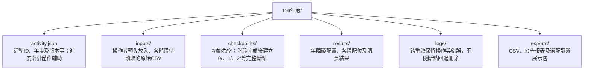
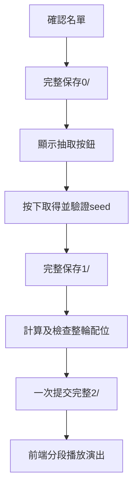

# 工作資料夾、匯入與階段存檔

狀態：已確認啟動操作及以完整階段資料夾為斷點的恢復規則；具體檔名、schema與寫入實作仍為草案，尚未建立前端或檔案讀寫功能。

## 工作資料夾就是一個年度活動

啟動時以`./start.sh --workspace "年度目錄"`指定工作資料夾，Go負責讀寫，Chrome不再選資料夾。發布包與資料目錄分離，見[啟動規格](../architecture/local-launch.md)。沒有活動紀錄時，建立該年度活動，所有階段初始為未執行；已有紀錄時，依最後完整存檔恢復；seed尚未完成保存時可回到抽取按鈕，細節見下方階段斷點。已結案活動預設唯讀，可查詢、匯出及重播。

每年度獨立建資料夾，117年度不繼承116年度的放棄、兩輪意願、入帳與配位。瀏覽器暫存只作當天恢復用途，外部工作資料夾才是可攜的持久來源。結案後連同當年建置好的離線程式及啟動說明整包備份至Drive，避免隔年依賴舊開發環境。

建議結構：

CSV檔名可先用A棟資料.csv、B棟資料.csv、無障礙車位資料.csv、第一輪繳費狀態.csv；這是命名草案，具體規則待定。程式依活動紀錄及內容驗證，不從資料夾或檔名推定活動年度、階段完成或繳費截止。

## 已確認：JSON存檔、CSV對外交換

所有正式階段存檔以JSON為標準格式，包含標準化名單、車位池、seed證據、配位、清票結果及進度相關資料。程式恢復及階段銜接均讀JSON，不以CSV作內部存檔或中間格式。

CSV僅在邊界轉換：外部工作表CSV放入inputs，匯入時驗證並轉為JSON；對外提供結果時由已完成JSON存檔產生CSV，放入exports。輸入來源檔名與摘要可記入JSON，原始CSV留在inputs，不要求複製進0/或將CSV列為斷點完整性的必要檔案。需要原始內容快照時也採JSON表示，具體schema待定。

匯出是獨立操作，不是配位完成條件；CSV匯出失敗不影響已完成的JSON斷點，可從相同JSON重做匯出，不重新抽選。JSON為唯一正式依據，外部修改CSV不會自動改變既有存檔。

## 第一輪匯入

1. 操作者先將CSV放進inputs，不必在網頁逐個上傳。
2. 新活動首頁顯示「匯入第一輪抽籤」。
3. 按下確認後，才讀取A棟、B棟與無障礙車位三份CSV；不因繳費CSV已存在就一併讀取。
4. 檢查三份檔案、欄名、戶號、選項、重複、無障礙順位及名額，轉為TS核心使用的標準資料。行政CSV可保留文字下拉選項，由程式轉成0／1／2等代碼，不要求行政先改碼。
5. 全部驗證成功後，保存JSON輸入快照與標準化存檔，連同兩輪意願固定下來，以完整0/作為資料已備妥的斷點；活動索引若有保留，由實際完整斷點推導。
6. 首頁進入第一輪演出準備；此時尚未抽選，匯入確認與抽選按鈕是不同操作。

之後抽選與重播都讀取確認過的存檔，不再每次回頭讀原始CSV。替換inputs內檔案不會自動變更已確認的名單。

## 第一輪繳費匯入

此為第二次外部資料匯入，不是第二輪抽選本身。

1. 第一輪各段已完成並保存，繳費期限後由操作者核對實際入帳。
2. 操作者將第一輪繳費狀態CSV放入inputs。
3. 到繳費清查階段才顯示可執行的繳費匯入／確認操作；未完成第一輪不能跳過配位直接清票。
4. 確認後讀取繳費CSV，驗證戶號及勾選值，轉為明確布林或標準代碼，保存本次繳費JSON快照。空白與不合法值不得默認未繳。
5. 根據已保存的第一輪配位與入帳快照產生清票結果；第一輪剩餘加上未繳釋出，形成各類第二輪候選池。
6. 清票確認保存後，再進第二輪準備，沿用第一次匯入保存的兩輪意願及已確認資格，不要求重讀A／B棟。

CSV繳費值的可接受表示（例如Google下載的TRUE／FALSE及系統0／1）須明定並測試，不以一般字串truthiness判定付款。

## 已確認：完整階段資料夾就是恢復斷點

使用者確認：每個資料處理階段執行完，才保存該階段的完整資料夾；演出不算存檔階段。初始存檔資料夾為空。以下以既有草案的`checkpoints/`為存檔根目錄，0／1／2代表本次討論的確認名單、取得seed及配位完成三個斷點；實際檔案schema、後續清票／第二輪編號，另行設計。第一輪A／B與大小腳踏車共用本輪seed並一次算完，不為每個演出段落另建seed／結果斷點。

| 完整斷點 | 保存內容 | 重啟後行為 |
| --- | --- | --- |
| 無 | 尚未完成名單確認 | 顯示匯入／確認名單 |
| `0/` | 已確認的A／B棟與無障礙名單、JSON輸入快照、標準化資料、參與名單及車位池 | 顯示抽取按鈕 |
| `1/` | 整輪共用的已驗證drand round、seed、鏈資訊與原始簽章證據、按鈕與請求時間、對應輸入識別 | 沿用該seed計算配位，不重新取得seed |
| `2/` | 計算並驗證完成的整輪A棟、B棟、大／小腳踏車配位結果與對應seed／輸入識別 | 讀取既有結果，可播放或重播演出 |

正常順序：

**判定以完整存檔為準，不以曾經送出請求、收到回應或畫面已顯示seed為準。** drand已回應但1/尚未完成保存就關閉，重啟仍恢復到0/，顯示抽取按鈕；由操作者再次按下後重新請求latest，允許取得新的round與seed。這是已確認的恢復規則，不要求從未完成暫存中找回上一次seed，也不在重啟時自動請求。

1/已完成而2/未完成時，沿用1/重新計算；2/已完成時直接使用結果，取消或中斷演出都不回退seed及配位。已完成的斷點不覆寫，也不因畫面操作退回重新抽選。

寫入的技術提案：先寫`<階段>.pending/`，全部檔案寫入並檢查完成後，由Go將其提交為正式數字目錄。暫存目錄不是完成斷點，也不強制恢復其中seed。實際提交、持久化與完整性檢查需實測；不能只看到數字目錄存在就認定成功，也不能直接把多檔寫入稱為一次原子交易。

使用者確認：完整性檢查發現正式存檔缺損或寫檔損壞時，應報錯並保留現場資料以debug；不自動修復、刪除或當作正常斷點回退後重抽。正常關閉前尚未完成階段，與已提交存檔損壞是不同情況。

## 已確認：手動移除某階段起的尾端存檔後重啟

操作者可關閉程式，手動刪除某階段及其後全部階段的存檔資料夾，或將整段尾端資料夾移到工作目錄外留存，再重啟；程式依剩下的完整斷點恢復。程式不自行刪除、修復或執行回退，也不另外要求修改進度索引。logs/保持不動。

| 手動操作 | 重啟後行為 |
| --- | --- |
| 移除最後的2/ | 從1/讀取原seed重新計算，固定輸入與算法下結果相同 |
| 移除1/及其後全部階段 | 從0/顯示抽取按鈕，再次按下取得新的latest seed |
| 移除0/及其後全部階段 | 回到匯入／確認名單 |

可一次移除多個尾端階段，但須一併移除依賴它的後續階段；若仍有後續階段卻缺中間斷點，屬資料鏈不完整，應報錯，不把後續結果自動接到其他輸入。已匯出的CSV或公告不會隨回退自動撤回；後續重新匯出與舊產物辨識方式待設計。

activity.json若保留進度，只作可重建的輔助索引。手動移除尾端斷點後，舊進度不能阻擋啟動；依完整且連續的正式階段資料夾重新推導進度。活動識別、版本或斷點內容損壞仍報錯，不與正常移除尾端資料夾混為一談。

## 已確認：獨立logs目錄保留操作歷程

年度工作目錄設置獨立`logs/`，記錄程式做過什麼與執行結果。回退只移除checkpoints內指定階段起的尾端存檔，不刪除或覆寫logs；重新執行相同階段時新增紀錄，讓先前操作與錯誤仍可追查。logs隨年度資料一起備份，不放在發布目錄，也不提交Git。

恢復進度仍以現存完整斷點為準。log記載曾完成1/或2/，不代表該斷點目前仍有效；不能因舊log阻止人工回退，也不從log還原已移除的seed或配位。

格式提案：採JSON Lines（`.jsonl`，每行一筆JSON），每次啟動建立新session檔，執行中追加，不覆寫舊session。具體欄位、檔名、寫入時機與log寫入失敗處理仍待設計。

建議記錄事件：

- 啟動與正常關閉：session識別、程式版本、年度活動識別及當次觀察到的斷點。
- 操作開始、成功或失敗：匯入、驗證、取seed、計算、提交斷點、匯出、重播與錯誤；區分「取得seed」和「seed斷點已提交」。
- seed事件附round與seed識別；結果及匯出事件附來源斷點、結果摘要或操作識別，區分同一階段的多次執行。
- 重啟檢查：目前有效斷點、先前紀錄曾出現但現在缺少的尾端階段，以及恢復到哪個操作。

最小欄位建議包含時間與時區、sessionId、operationId、事件、階段、狀態與相關識別／錯誤；不重複整份住戶名冊或配位，資料本體由階段JSON保存。

程式關閉時的手動刪除無法即時記錄確切時間、操作者或原因。重啟只能記錄「觀察到尾端斷點減少」，不宣稱確知是刪除、搬移或資料夾還原造成。意外斷電也可能來不及留下最後事件；log供除錯與追查，不取代完整斷點或第三方簽章。

## 保存與失敗處理

- 匯入與抽選都由使用者明確操作觸發，不監看資料夾後自動抽選或清票。
- 缺檔、格式錯誤或驗證失敗時，不建立完成斷點；正常執行中斷後恢復最後完整斷點。寫檔錯誤明確報錯，保留現場資料供debug。
- 正式階段資料夾及其完整性為恢復依據；activity索引屬輔助資料，不可單獨宣稱階段完成或取代已保存斷點。尾端斷點移除造成的舊進度索引依現存完整斷點重建；中間缺段或正式內容損壞則報錯，具體契約待設計。
- 紀錄輸入檔名、匯入時間、內容摘要及使用版本，方便辨識採用了哪次資料。更正需走明確流程，不覆蓋已確認結果。
- 演出不參與斷點提交，結果保存後才播放；演出中斷不影響已完成配位，重播沿用既有結果。
- 已提交存檔缺損、損壞或版本不相容時明確報錯，不默默重建活動。格式升級另留備份與遷移紀錄。
- Go依啟動參數取得年度目錄並處理讀寫；具體API、保存提交與完整性判定方式待設計。

三個操作階段的整體銜接見[活動階段與CSV產出](activity-states.md)。
