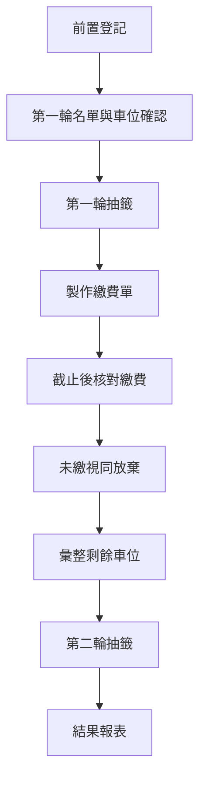

# 活動流程

## 已知主流程

程式分階段讀取工作表與產生CSV的規劃，見[活動階段與CSV產出](../design/activity-states.md)；本次日期見[116年度抽選時程](schedule-116.md)。第一輪繳費紀錄保留於第一輪工作表，清票確認後另產生第二輪工作表。

已確認程式操作分三段：第一輪匯入A／B棟與無障礙CSV並輸出抽選結果；清票匯入第一輪繳費CSV、搭配已保存配位輸出清票結果；第二輪沿用登記快照與清票結果抽選。具體輸入輸出契約集中於上述活動階段文件。

三類均支援兩輪；第二輪無參與者跳過，有參與者但實際車位不足時先補候補項目再抽選。第一輪未繳釋出也適用大／小腳踏車，第二輪名單以第一階段各類兩輪登記快照為準，第一輪未繳仍可參加。

| 階段 | 輸入或行政作業 | 預期產出 |
| --- | --- | --- |
| 前置登記 | 機車全戶預設第一輪；登記無障礙需求、放棄、第二輪意願；腳踏車大小另登記參與 | 原始登記名冊 |
| 第一輪準備 | 核對資格、戶別、車位與不參加名單 | 經確認的本輪輸入 |
| 第一輪抽籤 | 現場按鈕操作、直播展示 | 配位結果與報表 |
| 繳費 | 繳費單、期限與核對作業 | 繳費狀態與放棄名單 |
| 第二輪準備 | 剩餘車位、登記意願及資格核對 | 第二輪輸入 |
| 第二輪抽籤 | 雙抽車位與戶號，各類不足補候補項目 | 第二輪配位及各類候補順位 |
| 結案（提案） | 整合配置、保存各階段紀錄 | 當年度封存檔案 |

## 流程設計提案

兩輪皆固定先抽車位、再抽戶號。第二輪各類參與戶數多於該類實際車位時，按差額加入候補1、候補2等項目一起抽；未繳後由行政依候補順序遞補，不舉辦第三輪。完整規則見下方第二輪候補與遞補。

機車第一輪名單以全戶主檔為起點，排除主動放棄及已獲配無障礙位者。行政人員未修改且保留預設「一輪」的戶別仍須參加，不能因未另外回覆而排除。表格空白或不合法值應報錯，不自動套成放棄。

主動放棄不指定某個車位空出：先完成該棟正常配位，再把實際未配位車位加入第二輪候選清單。第二輪車位來源為第一輪未配位車位及截止清票後的未繳釋出車位，需依車位號碼去重；參與者按第一階段已保存的各類兩輪登記建立，不因第一輪未繳而排除。

第一輪機車位已配給住戶但期限後核對未繳者，視同放棄該次分配，將原車位釋出至第二輪。須保留原配位與清票結果，不能刪除第一輪配位紀錄或改寫成第一輪未抽中。期限前未勾選入帳不等於已放棄；第二輪參與仍以第一階段登記為準。

- 各輪保留輸入快照，後續更正不覆蓋當次依據。
- 分開記錄主動不使用、資格不符、未抽中與逾期未繳；公開顯示名稱與範圍另行確認。
- 第二輪名單沿用第一階段該類兩輪登記；未登記兩輪者不自動加入。
- 截止後先核對繳費，再產生釋出車位名單；目前不假定自動判定或串接銀行。
- 各輪結果與繳費紀錄分開保存，便於查核。

## 已確認：第二輪候補與遞補

機車、大腳踏車、小腳踏車各自計算候補數`max(0, 參與戶數 - 實際車位數)`，各類候補從1開始，不共用或跨類遞補。機車仍為A／B合併池。例：某類10格、15戶，補入候補1至候補5，所有參與戶以雙抽取得實際車位或候補順位。

實際車位按既定規則排序，候補按順位數字升冪附在該類實際車位之後，固定於4/；候補與實體車位使用不同類型，不計入實際容量。即使某類實際車位為0，有登記戶仍抽取候補順位；沒有參與戶才跳過該類。

6/保存各類實際配位及候補戶／順位。第二輪未繳而釋出的車位，由行政按同類候補1、候補2等順序遞補，不重抽、不再取seed，也不舉辦第三輪。多格釋出後的實際交付由行政處理。

此候補規則適用第二輪三類，不延伸為第一輪候補。TS／Go v2工具已驗證此抽選機制；Python原型尚未更新，正式活動存檔與前端仍待串接。
