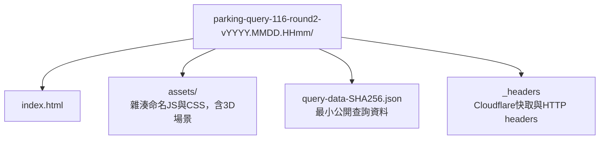

# 離線建置住戶查詢網站

狀態：已實作；腳本只建置本機靜態檔案，不自動發布至Cloudflare。115歷年相容性預覽已由使用者授權手動部署，見[部署紀錄](deployment.md)。

## 入口與前提

- Shell入口：[script/build-query.sh](../../../script/build-query.sh)。
- Go唯讀資料轉換：[query/export.go](../../../server/src/internal/query/export.go)，Cobra子命令`export-query`。
- Vue查詢入口：[query-main.ts](../../../client/src/query-main.ts)與[獨立Vite設定](../../../client/vite.query.config.ts)。
- 需本機Go、Node、npm；先在repo執行`npm ci`，並事先備妥server的Go module cache。腳本以`GOPROXY=off`、`GOSUMDB=off`、`GOTOOLCHAIN=local`建置，不自動下載依賴。

此工具獨立於Go server，不需啟動Gin或Chrome，不呼叫drand、不寫入年度存檔、不建立workspace鎖定檔或log。建議在年度操作關閉後建置；轉換前後會各驗證讀取一次，若過程中存檔變更則停止。

## 使用方式

從repo根目錄：

```sh
./script/build-query.sh --help
./script/build-query.sh --workspace ~/testwork-waitlist

# 明確輸出第一輪，即使該workspace已完成第二輪也可回看第一輪結果。
./script/build-query.sh --workspace ~/testwork-waitlist --round 1

# 明確輸出兩輪綜合版，指定新的輸出目錄。
./script/build-query.sh --workspace ~/testwork-waitlist --round 2 --output tmp/query-demo
```

| 參數 | 規則 |
| --- | --- |
| `--workspace` | 與query-data擇一；包含完整JSON斷點的年度目錄 |
| `--query-data` | 與workspace擇一；已整理好的查詢專用testMode JSON，不需要seed或0至6 |
| `--round` | 預設auto；完整到6選兩輪，否則需完整到2選第一輪；可明確指定1或2 |
| `--output` | 選用；必須尚不存在，拒絕覆寫目錄、檔案及symlink |
| `--help` | 顯示用法，不讀取存檔或建置 |

相對路徑依呼叫位置解析，不依腳本位置。預設輸出位於repo的`dist/parking-query-<民國年度>-round<輪次>-vYYYY.MMDD.HHmm/`，版本使用台灣建置時間。同分鐘重建需另指定新輸出路徑或稍後再建置，不覆寫前次包。

## 輸出與預覽

成功會印出`Query site: <絕對路徑>`；以該目錄作為Pages上傳來源，不能上傳整個workspace。



用HTTP靜態伺服器預覽，不直接雙擊HTML（瀏覽器對file URL的module與fetch有限制）：

```sh
./script/preview-query.sh --site tmp/query-demo
```

預覽腳本會自選loopback埠並開啟Chrome，Ctrl+C停止；詳細說明見[preview-query](../preview-query/tool.md)。直接雙擊HTML時會顯示操作提示。

網站可輸入`999-2`或`999-02F`，同時列出該戶各類有效車位與候補，點選可重播單筆3D進場。第一輪已釋出結果另列歷史，不混入有效車位。頁面採全版場景與中央戶號輸入；桌面右側、手機底部提供可收合儀表板，未手動調整時鏡頭跟隨車輛，可勾選馬上就位；WebGL無法使用時仍保留文字結果。

## 保存、公開資料與失敗處理

所有斷點會沿用既有驗證器核對schema、drand簽章、輸入與算法結果。第一輪讀取活動及0至2，兩輪結果使用4的保留配置與6的新增結果；來源若還有後續斷點，整條現存鏈也須有效。缺段、已提交資料損壞或來源中途變更均拒絕匯出，不猜測或自動修復。

公開JSON只包含年度、輪次、建置時間、演練標記、必要無障礙拆分資訊及戶號／各輪車位／候補／釋出狀態。原始登記意願、付款明細、seed、亂數串流、來源CSV、logs與完整checkpoint不輸出。純靜態頁不提供戶號存取授權。

建置失敗回傳非零，暫存建置目錄會清理；既有來源與既有輸出保持不變。最終檔案複製失敗時可能留下未完成的新輸出目錄，不能將其當成成功包，應另指定新目錄重建。建置及預覽均不會自動部署。

## 驗證

```sh
go -C server test -race ./src/internal/query ./src/cmd
npm run test:browser -- query-export.spec.ts
```

Go測試涵蓋第一輪／綜合版語意、已釋出歷史、最小公開欄位、缺段與損壞拒絕。Chrome測試直接讀腳本建置的兩個靜態包，確認手機查詢、3D、同網址換版、無API請求、無外部資源請求、拒絕覆寫及來源JSON不變。使用虛構年度存檔，未操作正式資料或Cloudflare。

完整發布規格與Wrangler範例見[住戶查詢與Pages發布](../../design/resident-query.md)。

## 歷年相容性預覽

已提供`--query-data`入口，只接受testMode=true的最小公開JSON，不將其宣稱為已驗證的抽籤存檔。資料會檢查未知欄位、車種類型、戶號、車位範圍與有效配置唯一性、候補順位；建置時間使用本次實際時間。正式年度仍以`--workspace`驗證完整存檔。

```sh
./script/build-query.sh --query-data testdata/previous-year/query-round2.json --output tmp/previous-year-query
```

本機歷年來源與兩份查詢JSON見[previous-year](../../../testdata/previous-year/README.md)，含真實戶號，JSON已忽略Git。此用途為先上傳Pages讓住戶測試裝置，並不把抽選後端上線。
