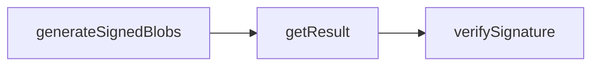

# random-org-seed 測試紀錄

操作入口與工具定位見[工具說明](tool.md)。

## 驗證狀態

目前已完成5項TS測試，包含seed參數、敏感值遮蔽、格式檢查、模擬generate/get完整流程、拒絕覆蓋及無重試的網路失敗記錄。使用者已於本機完成兩筆真實請求測試（serialNumber 1及2）：generate取得不同256-bit seed，getResult兩次皆matchesOriginal=true，verifySignature兩次皆authenticity=true。來源為使用者提供的執行輸出；未由agent再次呼叫API或消耗額度。seed原文、完整收據及帳號資訊不寫進本文件。

取得seed與取回紀錄的signatureVerified=false表示該操作未執行簽章驗證，不代表驗證失敗；獨立verify操作的authenticity=true才是第三方驗證結果。正式整合時可將驗證結果關聯到同一份收據，不修改第三方簽章原文。

### 真實API測試紀錄

測試日期：2026-10-26（臺灣時間）。操作者：使用者於本機終端執行。證據來源：使用者在對話提供的六次成功指令輸出；以下未額外呼叫API，也未獨立重新讀取原始收據。

| 項目 | 第1筆 | 第2筆 |
| --- | --- | --- |
| serialNumber | 1 | 2 |
| completionTime（第三方UTC） | 2026-10-25 17:09:05Z | 2026-10-25 17:12:18Z |
| 對應臺灣時間 | 2026-10-26 01:09:05 | 2026-10-26 01:12:18 |
| seed格式 | 64個hex字元，256-bit | 64個hex字元，256-bit |
| generate signaturePresent | true | true |
| get matchesOriginal | true | true |
| verify authenticity | true | true |
| 原始回應目錄 | tmp/seed-live-001 | tmp/seed-live-002 |
| 取回紀錄目錄 | tmp/seed-fetched-001 | tmp/seed-fetched-002 |
| 驗證回應目錄 | tmp/seed-verified-001 | tmp/seed-verified-002 |

兩筆seed不同。兩次get均確認random物件及signature與原收據一致；JSON-RPC外層請求id不列入歷史紀錄相同比對。兩次獨立verify均成功，說明收到的random物件及簽章可通過第三方驗證。

兩筆userData均為purpose=parking-seed-format-test、activityYear=116、stage=test-only，不是正式抽選。此測試只驗證seed服務及收據流程，未產生任何住戶配位，亦未驗證本機seeded PRNG或配位重現功能。

目前結論：下圖的真實服務流程可行。帳號免費／付費授權、額度及適用範圍不由這兩次成功回應推定；本次未核查帳號方案。



上述tmp目錄為本機測試產物，受.gitignore排除且不保證長期留存。正式活動應將完整random、signature、驗證回應及其關聯納入年度封存，不能只保留本文件的摘要表。

```bash
node --test tests/random-org-seed.test.mts
```

官方契約：[Signed API Release 2](https://api.random.org/json-rpc/2/signed)。固定endpoint為`https://api.random.org/json-rpc/2/invoke`；其他API release的端點不在此腳本範圍。
