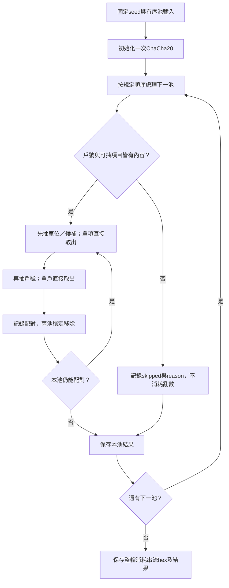

# 驗證工具v2資料契約

狀態：v2驗證工具已實作此輸入與結果契約。正式0至6存檔的包裝schema尚未建立；此工具契約先供算法驗證與後續串接使用。舊v1向量與實測另保留作歷史紀錄。

## 工作範圍

先更新驗證工具，不建立正式活動後端或前端。TS與Go各自讀同一份有序池JSON及同一seed，獨立產生消耗串流與雙抽結果；shell負責seed工具、兩個worker與結果比對。驗證目的為可重現與跨語言一致，不要求大量分布統計。

正式存檔仍依[各階段共通原則](../../design/workspace-storage.md)：不在結果複製seed、整份有序輸入或來源摘要，驗證時按順序讀取。工具輸出目錄可另外保存一份本次使用的有序池輸入，作為工具測試包的輸入，不能因此把所有資料塞入2/或6/。

## 有序池輸入

[JSON Schema](../../../examples/verify-draw/pools.schema.json)定義`schemaVersion`、`drawRound`與`pools`。

| 欄位 | 內容 |
| --- | --- |
| schemaVersion | 測試輸入格式版本，1 |
| drawRound | 1或2 |
| pools | 依固定順序的陣列，包含空池，不能省略或換序 |
| pool.id | 第一輪motorcycle_a、motorcycle_b、bicycle_large、bicycle_small；第二輪motorcycle、bicycle_large、bicycle_small |
| pool.households | 已由上游依規則排序的文字戶號，單池不得重複 |
| pool.candidates | 已排序的實際車位及候補項目；實體車位為type=space、spaceId，候補為type=waitlist、rank |

worker依陣列順序執行，不偷偷重新排序。候補只出現在第二輪，各類按差額補足，rank由1連續編號，排在實際車位之後。第二輪候補數必須等於max(0, 戶數-實際車位數)，沒有參與戶時不加入候補。正式4/負責準備；驗證工具檢查準備資料符合此規格，不在抽選途中補候補。

Schema只檢查形狀、欄位與池順序；實際編號範圍、戶別分棟、數字排序、候補數／順位、同類跨池重複等需語意檢查。虛構小池測試只驗證算法，不代替正式社區容量及戶號驗證。

## 算法版本與輸出

新算法識別為`parking-draw-chacha20-v2`，不沿用v1。ChaCha20維持IETF 20 rounds、32-byte seed作key、12-byte零nonce、初始counter=0、每4 bytes大端序uint32。



取值直接`random % 當前大小`，無拒絕取樣；大小1時不讀bytes。原始串流只記錄實際讀取的bytes，不保存ChaCha20最後一個區塊未用到的尾端。候補與實際車位同樣占一個抽取項目；取得候補不列為實體車位配位。

[結果JSON Schema](../../../examples/verify-draw/result.schema.json)定義輸出。結果包含schemaVersion、整輪status／reason、algorithm、nonce、initialCounter、uint32Endian、poolRemoval、streamHex與各池結果。各池包含id、status、reason、assignments、waitlist、unassignedHouseholds、remainingSpaces；waitlist依rank輸出，實際配位保留抽出順序。結果不含逐步trace、輸入摘要或seed副本。

跳過原因代碼：no_participants、no_candidates、no_participants_and_no_candidates；正常完成reason為null，集合為空陣列而非null。僅有候補的第二輪池屬有抽取內容，不算skipped。單戶單候補配對也屬完成，消耗串流可為空。整輪皆skipped時，shell仍須取得並保存drand seed。

## CLI

保留既有`--input`表示seed證據目錄，新增`--pools`表示上述有序池JSON，避免改變既有參數意義。v2支援下列用法：

```sh
./tools/verify-draw.sh --round 33382601 \
  --pools examples/verify-draw/round-one.json \
  --output tmp/verify-v2-first-001

./tools/verify-draw.sh --input tmp/verify-v2-first-001/seed \
  --pools examples/verify-draw/round-two.json \
  --output tmp/verify-v2-second-001
```

上述重用seed僅用於算法驗證；正式第二輪另取本輪seed。可用--expected指定保存結果；比較包含串流與全部結果，詳見[工具說明](tool.md)。

## 已準備的虛構情境

| 檔案 | 驗收內容 | 預期消耗uint32數 |
| --- | --- | --- |
| [round-one.json](../../../examples/verify-draw/round-one.json) | A等量雙抽、B有剩位、腳踏車單項不消耗、無戶池跳過 | 7 |
| [round-two.json](../../../examples/verify-draw/round-two.json) | 機車不足補候補、大腳踏車全候補、小腳踏車無戶跳過 | 6 |
| [all-skipped.json](../../../examples/verify-draw/all-skipped.json) | 所有池皆無戶，保留剩位，仍取seed | 0 |
| [first-round-shortage.json](../../../examples/verify-draw/first-round-shortage.json) | 第一輪位少於戶、單車位不消耗，抽戶決定取得者，不加入候補 | 1 |

每個uint32消耗4 bytes；全候補也要按雙抽規格消耗。固定公開seed的v2結果已由兩份實作交叉驗證後保存，見[測試紀錄](testing.md)。

目前負面測試包含重複戶號／項目、池順序錯誤、第一輪帶候補、第二輪候補不足／多餘／跳號、未知類型、錯誤seed、拒絕覆寫及串流／結果篡改。固定公開seed與全零、全ff等測試seed需重跑一致，並保留ChaCha20已知測試向量。
