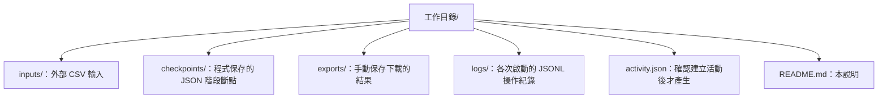

# 年度抽選工作目錄

此目錄由 parking 啟動時建立；請每年度使用獨立目錄。重新啟動會補齊缺少的基本資料夾，保留既有檔案與本說明。

## 第一次抽選前

將 Google Sheets 各分頁下載為 UTF-8 CSV，放入 `inputs/`，檔名必須是：

- `A棟資料.csv`
- `B棟資料.csv`
- `無障礙車位資料.csv`

A／B 棟表頭為 `戶號,機車位,腳踏車（大）,腳踏車（小）`，各類登記值為 `0`（放棄／不參與）、`1`（一輪）、`2`（兩輪）；也接受樣板的文字下拉選項。無障礙表格請直接使用工作表樣板匯出的欄位，不自行改名。

啟動不會自動匯入或抽選。前端確認開始後才讀取資料；請先確認測試／正式模式與年度。

## 繳費清查前

將 `第一輪繳費狀態.csv` 放進 `inputs/`，在前端執行「匯入繳費並清票」。繳費勾選請保留 Google Sheets 匯出的 TRUE／FALSE，空白不視為未繳。清票結果可用來確認是否需要第二次現場抽選。

## 結果與存檔

結果先存成 `checkpoints/` 內的 JSON，演出不影響存檔。前端按下載後，CSV 由 Chrome 下載；請手動選擇或搬到 `exports/`，再上傳 Google Drive，程式不會自動將瀏覽器下載寫入此處。

| 階段目錄 | 內容 |
| --- | --- |
| `checkpoints/0/` | 第一輪名單、無障礙配置及車位池 |
| `checkpoints/1/` | 第一輪 drand seed 與證據 |
| `checkpoints/2/` | 第一輪配位及消耗串流 |
| `checkpoints/3/` | 繳費資料匯入 |
| `checkpoints/4/` | 清票結果、第二輪名單及車位池 |
| `checkpoints/5/` | 第二輪 drand seed 與證據 |
| `checkpoints/6/` | 第二輪配位及消耗串流 |

階段目錄完成後才產生；空白目錄不代表完成。更換 inputs 不會修改已確認的存檔。需要回退時先關閉程式，將指定階段及其後全部階段移出 checkpoints，保留 logs，再重啟；已提交檔案損壞會報錯，供除錯使用。

備份時保存整個年度目錄及對應版本的發布包。`.parking.lock` 是程式的工作目錄鎖定檔，不是階段紀錄。
